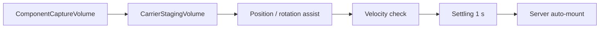
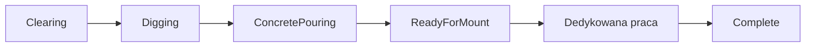

# Budowa mostu

## Status

**Główne części mostu mają workflow; fizyczne płyty obejmują Etapy 1–4.**
Etapy 1–3 fizycznych płyt zostały ręcznie zaakceptowane; Etap 4 integracji z globalnym progresem i księgą jest wdrożony i technicznie zwalidowany. Użytkownik potwierdził działanie poprawki paneli; późniejsze porządkowanie sceny zostało wykonane na jego prośbę i nie ma osobnej akceptacji wizualnej. Checklisty Etapu 4 nie są dowodem osobnego sprawdzenia każdego scenariusza. Pozostałe elementy mostu zachowują opisane niżej workflow.

## Dane części

### `BridgeComponentSO`

| Pole | Znaczenie |
|---|---|
| `componentName`, `componentSprite` | Nazwa i ikona HUD/fabryki |
| `componentPrefab` | Holder/finalna część mostu |
| `bridgeComponentType` | Ogólna kategoria legacy/UI |
| `componentAdvancementLevel` | Poziom technologiczny; obecnie słabo wykorzystywany |
| `supportedEquippableItemTypeList` | Narzędzia prostego assembly |
| `assemblingProgressNeeded` | Progress prostego montażu |
| `needAssembling` | Czy po mount wymagane jest assembly |
| `constructionWorkflow` | Fundament |
| `abutmentConstructionWorkflow` | Przyczółek |
| `girderConstructionWorkflow` | Dźwigar |
| `crossBeamConstructionWorkflow` | Belka poprzeczna |
| `diagonalBracingConstructionWorkflow` | Stężenie |
| `deckPanelConstructionWorkflow` | Panel |

Przypisuj tylko workflow odpowiadający typowi prefaba. Część bez dedykowanego
workflow zachowuje prosty mount/assembly.

## `GameplayManager`

| Pole | Znaczenie |
|---|---|
| `bridge` | Kontener wszystkich scenowych holderów |
| `bridgeComponentDataArray` | Synchronizowany stan komponentów |
| `bridgeBuildingStages` | Kolejność etapów i wymagane części |
| `currentBridgeBuildingStageIndex` | Stan runtime/initial debug |
| `isFullyAsembled` | Stan ukończenia; nazwa zawiera historyczną literówkę |
| `enableRiverBedResourceRemoval` | Globalnie włącza cleanup `BaseResourceNew` na dnie rzeki |
| `enableUnsupportedWaterDowning` | Włącza downed po timerze braku bezpiecznego podłoża |

Każdy `BridgeComponent` musi mieć unikalny `componentID`, który odpowiada
elementowi stanu. Manager odblokowuje tylko części aktualnego etapu i po
ukończeniu wszystkich wymagań przechodzi dalej. Ukończenie ostatniego etapu
wywołuje victory.

`BridgeComponentNetworkState` przenosi mount/assembly, stage, progress,
dwie wartości całkowite, cztery progresy punktów i dwa pola pomocnicze.
Workflow interpretują te pola inaczej, ale nie zmieniają protokołu.

Podczas `Clearing` dedykowany trigger placu jest miękkim fallbackiem targetowania. Celowanie w pusty plac pokazuje prompt etapu, ale interaktywny albo podatny na obrażenia obiekt za triggerem przejmuje `CurrentTarget`. Po przejściu do `Digging` plac ponownie jest bezpośrednim celem pracy.

## `BridgeComponent`

| Pole | Znaczenie |
|---|---|
| `componentID` | Stabilny, unikalny identyfikator w managerze |
| `isMounted`, `canBeMounted`, `isAssembled` | Stan runtime/synchronizacji |
| `bridgeComponentSO` | Typ oczekiwanej części |
| `readyForMountingVisualsGameObject` | Ghost i trigger interakcji |
| `mountedComponentVisualsGameObject` | Finalny visual |
| `ghostMaterial` | Materiał podglądu |
| `mountedPhysicalColliders` | Collidery aktywowane według workflow |

Collidery ghosta powinny być triggerami. Fizyczne collidery niewidocznej
części są wyłączone. Dedykowane workflow może opóźnić collider aż do
`Complete` albo wyłączyć go po ukończeniu, jak fundament.

## Precyzyjne dostarczanie części

Pozostałe precyzyjnie dostarczane części tutorialowego mostu używają
`BridgeMountSocket`; fizyczne płyty (`physicalPanelPlacement=true`) są wyjątkiem
i nie korzystają z tego workflow. Samo wejście carriera w zasięg interakcji nie montuje już części. Serwer wymaga
jednocześnie poprawnego typu, aktywnego carry, obecności holderów w staging
volume, właściwej pozycji i rotacji oraz odpowiednio małej prędkości. Poprawny
stan musi utrzymać się przez `settleDuration`, domyślnie `1 s`.

| Pole `BridgeMountSocket` | Znaczenie |
|---|---|
| `targetPose` | Dokładna pozycja i bazowa rotacja montażu |
| `componentCaptureVolume` | Szeroka strefa wykrywania kompatybilnej niesionej części |
| `carrierStagingVolume` | Obszar, w którym muszą znajdować się wszyscy aktywni holderzy |
| `positionTolerance` | Dopuszczalny błąd pozycji w lokalnych osiach targetu; aktualnie `0.40 m` |
| `rotationToleranceDegrees` | Dopuszczalny błąd rotacji per oś; aktualnie `18°` |
| `maximumLinearVelocity` | Maksymalna prędkość podczas settle; aktualnie `0.35 m/s` |
| `maximumAngularVelocityDegrees` | Maksymalna prędkość kątowa; aktualnie `15°/s` |
| `settleDuration` | Czas nieprzerwanego poprawnego ustawienia |
| `requireRecommendedCarrierCount` | Wymaga pełnej docelowej obsady, niezależnie od testowego minimum pickup |
| `allowedOrientationOffsetsEuler` | Alternatywne poprawne orientacje względem `targetPose`, np. obrót `180°` |
| pola `Soft Assist` | Sprężyna, damping i limity przyspieszenia pozycji/rotacji |
| pola `Feedback` | Zasięg, grubość, kolory, skala obrysu i długości wskaźników |

Capture volume sześciu części jest powiększony o około `25%`, a staging volume
o około `20%` w X/Z. Obrys feedbacku skaluje bounds ghosta o `1.12` i dodaje
minimum `0.25 m` marginesu. Strzałki pozycji mogą mieć do `2.5 m`, a promień
wskaźników rotacji skaluje się z rozmiarem części. Runtime visuale nie mają
colliderów i używają `Ignore Raycast`.

Gdy jedna część znajduje się w kilku capture volume, tylko socket o najmniejszym
znormalizowanym błędzie pozycji i rotacji może stosować assist albo rozpocząć
settle. Remis rozstrzyga stabilny `componentID`. Zapobiega to przeciąganiu
jednej części przez sąsiednie sockety.

Legacy Support i Roadway bez `BridgeMountSocket` zachowują ręczny montaż.

## Bazowy `BridgeConstructionSite`

| Pole | Znaczenie |
|---|---|
| `requiresSiteClearing` | Włącza etap oczyszczania |
| `clearingAreaSize` | Rozmiar wizualnego obrysu |
| `clearingObstacles` | Jawna lista zasobów wymagających Axe |
| `constructionInteractionCollider` | Collider routujący prompt/work |
| `markedGroundVisual` | Obrys clearing |
| `diggingVisual` | Visual aktywnego wykopu |
| `completedDigVisual` | Visual gotowego dołu, tylko przed mount |
| `hideMountedVisualsWhenComplete` | Ukrywa finalny visual po ukończeniu |
| `disablePhysicalCollidersWhenComplete` | Wyłącza collider root/final po ukończeniu |

Pusta lista aktywnych przeszkód automatycznie kończy clearing. `CompletedDig`
powinien zniknąć po dostarczeniu fundamentu.

## Workflow

### Fundament

`Clearing -> Digging -> ConcretePouring -> ReadyForMount -> Hammering -> Complete`

Gotowa partia jest transportowana zadokowaną taczką i wylewana przez dwóch
graczy. Poprawne wlanie uruchamia schnięcie, a po jego zakończeniu fundament
przechodzi do `ReadyForMount`. Krytyczna porażka pozostaje logicznie w
`ConcretePouring`; jej przebieg opisuje osobny `FoundationConcreteFailureState`.

### Cykliczne kopanie fundamentu

`Digging` fundamentu zawiera trzy cykle `Loosening -> SoilRemoval`. W każdym cyklu łopata musi nabić `60` work progress, po czym wiadrem trzeba usunąć netto `6` porcji ziemi. Cele kumulacyjne pozostają całkowite: `6`, `12` i `18` porcji; ułamkowy może być bieżący postęp pomiędzy tymi progami. Ukończenie trzeciego cyklu przełącza plac na `ConcretePouring`.

`SoilRemoval` ma limit czasu ustawiany przez `loosenedSoilHardeningDuration` (tutorial: `15 s`). Deadline rozpoczyna się przy wejściu w podetap i nie jest resetowany przez nabieranie ani zwracanie ziemi. Po upływie czasu plac wraca do `Loosening` z progresem `0`, zachowując liczbę usuniętych porcji i głębokość wykopu. Ponowne rozdrobnienie uruchamia świeży deadline; prompt pokazuje czas pozostały do stwardnienia.

Stan nie zwiększa rozmiaru pakietu mostu: `constructionValueA/B` przechowują indeks cyklu i `FoundationDiggingSubstage`, `constructionProgress` progres łopaty, `constructionAux0` (`RemovedSoilUnits`) ułamkową liczbę usuniętych porcji (`float`), a `constructionAux1` deadline stwardnienia w czasie serwera. Late join odtwarza podetap, głębokość oraz pozostały czas.

Wykop ma ruchomą powierzchnię ziemi, stałe ściany, dno i łagodną rampę. Głębokość wynosi `1.2 * removedSoilUnits / 18`, maksymalnie `1.2 m`. Zwrócona ziemia podnosi powierzchnię. `EarthPile` wrzucony podczas `ConcretePouring` albo przed montażem przywraca ostatni `SoilRemoval`. Po zamontowaniu fundamentu regres jest wyłączony.

### Przygotowanie betonu

Jedna wspólna betoniarka przy Blast Furnace przyjmuje dokładnie `6 Water`,
`6 Gravel` i `1 Cement Bag`. Pełne wiadro przekazuje trzy porcje po ukończonym
przytrzymaniu RMB. Betoniarka przyjmuje wyłącznie pełne wiadro i tylko wtedy,
gdy całe mieści się w pozostałej pojemności. Odmowa pozostawia zawartość wiadra
bez zmian; przyjęte pełne wiadro przekazuje wszystkie trzy porcje atomowo.
Niesiony worek cementu wkłada się przez E. Bęben mieści
`15` jednostek objętości; wiadro i worek zajmują po `3`.

Korba jest blokowana dla jednego operatora. UI z oporem zlicza sześć pełnych
obrotów zgodnie z ruchem wskazówek zegara, a częściowy progres pozostaje po
zmianie operatora. Mieszanie zaczyna naliczać progres od `6/15` objętości;
każdy kolejny pełny ładunek podnosi maksymalny progres o `20%`. Input na
aktualnym limicie nadal obraca korbę i bęben, ale nie zwiększa progresu ani nie
jest kolejkowany. Dokładny wsad daje `ConcreteReady`, pozostałe kombinacje
kończą jako `RuinedMix`. Przełączenie dźwigni na `Pouring` zwalnia operatora,
obraca bęben i bezpowrotnie opróżnia dowolną zawartość. Gotowy beton jest
ładowany do zadokowanej taczki i może zostać przypisany do konkretnego
fundamentu dopiero przez minigrę wylewania przy wykopie.

`BridgeConstructionWorkflowSO`:

| Pole | Znaczenie |
|---|---|
| `diggingTool` | Zwykle Shovel |
| `diggingProgressNeeded` | Łączny work progress wykopu |
| `diggingCycleCount` | Liczba par `Loosening/SoilRemoval`; tutorial: `3` |
| `looseningProgressPerCycle` | Work progress łopatą w jednym cyklu; tutorial: `60` |
| `soilUnitsPerCycle` | Porcje ziemi do usunięcia netto w cyklu; tutorial: `6` |
| `finalExcavationDepth` | Finalna głębokość fizycznej powierzchni; tutorial: `1.2 m` |
| `loosenedSoilHardeningDuration` | Czas do ponownego stwardnienia podczas `SoilRemoval`; tutorial: `15 s` |

Po mount foundation znika plac i sześcian wykopu. Industrial Hammer dodaje
assembly progress. Końcowy root collider może być wyłączony zgodnie z
ustawieniem stanowiska.

### Przyczółek

`WaitingForFoundation -> ReadyForMount -> Leveling -> Anchoring ->
Backfilling -> Complete`

| Pole workflow | Znaczenie |
|---|---|
| `levelingTool` | Narzędzie klinów |
| `anchoringTool` | Narzędzie czterech kotew |
| `backfillingTool` | Narzędzie zasypania |
| `maximumLogicalTilt` | Granica obu osi logicznych; tutorial: `8` |
| `minimumInitialTiltMagnitude` | Najmniejsza wartość losowana na początku; tutorial: `1` |
| `levelingSuccessTolerance` | Tolerancja zatwierdzenia; tutorial: dokładnie `0` |
| `visuallyStraightTiltRange` | Zakres ukrywany przez visual; tutorial: `-4...4` |
| `maximumVisualTiltDegrees` | Maksymalny pitch/roll części; tutorial: `3°` |
| `anchorProgressNeeded` | Progress jednej kotwy |
| `backfillProgressNeeded` | Łączny progress zasypania |

Poziomowanie ma niezależne osie długości i szerokości. Cztery kliny zmieniają
odpowiednią podpisaną wartość o jeden krok i pozwalają przestrzelić zero.
Prompty nie ujawniają wartości ani kierunku korekty. Odczyt wykonuje dwuslotowa
poziomica `SpiritLevel`: LPM przy jednej z czterech stref przykłada narzędzie i
pokazuje daną oś. Długość jest dostępna z przodu i z tyłu, a szerokość z lewej
i prawej strony. Lokalne cyjanowe obrysy widzi wyłącznie gracz z wyposażoną
poziomicą. Posiadacz Industrial Hammera widzi zamiast nich cztery pomarańczowe
cele wskazujące aktywne kliny; znaczniki nie ujawniają kierunku korekty.
Po ustawieniu `0/0` dowolny gracz zatwierdza wynik
przez E na części albo punkcie. Błędne zatwierdzenie losuje ponownie tylko
niepoprawne osie; poprawna oś pozostaje na zerze.

### Dźwigar główny

`WaitingForSupports -> ReadyForMount -> Leveling -> Fastening -> Complete`

| Pole workflow | Znaczenie |
|---|---|
| `levelingTool`, `fasteningTool` | Narzędzia etapów |
| pola logicznego/visualnego przechyłu | Te same dwie osie i ograniczony visual co przyczółek |
| `fastenerProgressNeeded` | Progress każdego z czterech mocowań |

Placeholder dźwigara ma około 14 m i przekracza tutorialową rzekę. Punkty
Start/End regulują długość, a Left/Right szerokość. Zakres `-4...4` wygląda
prosto, dlatego wiarygodne ustawienie wymaga pomiaru poziomicą i osobnego
zatwierdzenia E. Dopiero poprawne zatwierdzenie przechodzi do `Fastening`.

Cztery wizuale gwoździ są ukryte na luźnym, niesionym i upuszczonym
`WoodenMainGirderMountable`; wszystkie pojawiają się jednocześnie po wejściu
zamontowanego dźwigara w `Fastening`. Głębokość wbicia wynika z istniejącego,
synchronizowanego postępu poszczególnych mocowań, przy czym pary `0`↔`3` oraz
`1`↔`2` zachowują wspólną progresję. Zaakceptowane zmiany postępu animują się
wizualnie przez około `0,12 s` z cubic ease-out, natomiast stan początkowy po
pierwszym pokazaniu, wczytaniu zapisu lub dołączeniu spóźnionego klienta jest
ustawiany natychmiast; zduplikowany stan sieciowy nie uruchamia ruchu ponownie.
W `Complete` gwoździe są wymuszane jako całkowicie wbite i pozostają widoczne,
a interakcja oraz collidery `BridgeGirderWorkPoint` zostają wyłączone. Jest to
wyłącznie warstwa prezentacyjna oparta na istniejącym stanie sieciowym
`constructionAnchor0-3`; nie dodano nowego schematu sieciowego.

### Belka poprzeczna

`WaitingForGirders -> ReadyForMount -> Aligning -> Clamping -> Fastening ->
Complete`

| Pole workflow | Znaczenie |
|---|---|
| `alignmentTool` | Industrial Hammer |
| `clampingTool`, `fasteningTool` | Wrench |
| `maximumAlignmentStep` | Zakres przesunięcia |
| `alignmentStepDistance` | Metry na krok |
| `clampProgressNeeded` | Progress zacisku |
| `maximumClampProgressDifference` | Maksymalna przewaga jednej strony |
| `fastenerProgressNeeded` | Progress mocowania |

MoveLeft odpycha w prawo, MoveRight w lewo. Zaciski trzeba rozwijać
naprzemiennie, potem ukończyć cztery fastenery.

Prefab `WoodenCrossBeamBridgeComponent` zawiera child
`CrossBeamClampColliders`, z którego collidery `COL_Clamp.Left` i
`COL_Clamp.Right` są przypisane do opcjonalnego, domyślnie pustego pola
`disabledAfterAssemblyColliders` w `BridgeComponent`. Po ukończeniu całego
workflow (`Complete`: wyrównanie, oba zaciski i cztery fastenery) collidery
obejm pozostają wyłączone również wtedy, gdy workflow włącza główny collider
belki; widoczne modele zacisków pozostają na miejscu. Dotychczasowe reguły
aktywacji colliderów przed ukończeniem workflow nie zmieniają się. Konfiguracja
działa także dla `startFullyCompleted`, odświeżeń stanu i późniejszych snapshotów
NGO, korzystając z istniejącego stanu sieciowego.

Walidacja 2026-10-19: ścisły, nieprzefiltrowany preflight Gameplay zakończony
powodzeniem (exit 0; 14/14 kroków). EditMode: 125/125; PlayMode: 127/127,
w tym testy colliderów belki poprzecznej oraz synchronizacji z hostem, klientem
i późnym dołączeniem w jednym procesie. Raport:
[`summary.json`](D:/Programy/UnityProjects/RageQuitting/Artifacts/Validation/20261019T181113Z-0bf0ed09/summary.json).
Początkowy pełny przebieg miał jeden nieudany test sieciowego rozmieszczania
Stage1; późniejszy przebieg izolowany i końcowy pełny przebieg przeszły. Przyczyna
tamtego niepowodzenia nie została ustalona. Nie sprawdzano osobnego procesu,
player builda, WAN/Relay ani ręcznie wizualnego rozmieszczenia panelu.

### Stężenie ukośne

`WaitingForCrossBeams -> ReadyForMount -> Aligning -> TemporaryFixing ->
Fastening -> Complete`

| Pole workflow | Znaczenie |
|---|---|
| trzy tool fields | Alignment, temporary fix i final fastening |
| `initialAlignmentOffset` | Początkowa liczba kroków od celu |
| `maximumAlignmentStep` | Zakres kąta |
| `alignmentAngleStep` | Stopnie na krok |
| `temporaryFixProgressNeeded` | Progress każdego końca |
| `fastenerProgressNeeded` | Progress finalnego punktu |

Instancja holdera wybiera orientację `/` albo `\`. `ForwardSlash` ustawia
`MountTargetPose` i ghost na lokalny yaw `+45°`, a `BackSlash` na `-45°`.
Pozycja obu targetów pozostaje wspólna, ponieważ stężenia krzyżują się w tym
samym środku. Dozwolony offset `0/180°` oznacza odpowiednio `45°/225°` oraz
`-45°/135°`. Dzięki temu assist, błąd rotacji i arbitraż nakładających się
socketów odnoszą się do rzeczywistej przekątnej, a nie osi kontenera.

`alignmentStep` nie zmienia targetu dostarczania ani ghosta. Po montażu obraca
wyłącznie finalny `bracingVisualRoot` podczas etapu `Aligning`. Finalne
połączenia mają ścisłą kolejność krzyżową; aktywny punkt powinien pulsować i
zmieniać kolor.

### Panel pomostu — fizyczny produkt, Etap 1

`WoodenDeckPanelMountable` jest osobnym single-carry produktem dla jednego carriera. Flaga `physicalPanelPlacement` jawnie wybiera workflow; model/collider mają stałe wymiary `2.16 × 0.20 × 2.40 m`, a spoczynkowa masa Rigidbody wynosi `1 kg`. Sloty są pasywne i niezależne od prerequisite, kolejności oraz `CanBeMounted`; nie wykonują automatycznego montażu, assist, snap/capture ani fastenerów. Zwykłe E szuka wolnego miejsca przed graczem w zasięgu interakcji (domyślnie `2.5 m`), z uwzględnieniem gabarytu, holdera i przeszkód; przy braku miejsca płyta pozostaje w rękach bez zmiany ownership. F/E/Esc uruchamia osobny tryb precyzyjnego ustawiania o domyślnym zasięgu `2 m`. Host/klient są server-authoritative, a klient czeka na akceptację serwera przed lokalnym zwolnieniem. F/E/Esc i obrót nie dodają impulsu zwykłego E.

Historyczny układ fixture sprzed przeniesienia (migawka): w `NailTestArea` sceny `Assets/Experiments/TutorialTerrainStage02/Scenes/TutorialTerrainStage02.unity`, w `Stage1TestFixture` przy world `(-6,0,7.2)`, znajdowały się 3 płyty, 2 gotowe dźwigary, 3 miejsca na rozpiętości 6.56 m (szczeliny 4 cm) na dźwigarach 8 m oraz 36 dodatkowych gwoździ, 48 gwoździ łącznie w obszarze. Fixture leżał poza Bridge/global progress. Aktualny układ i jego testowe odpowiedniki opisuje follow-up „Porządkowanie sceny fixture gwoździ i płyt”.

### Ocena ustawienia i mocowanie — Etap 2

Każda sekcja `BridgeDeckSection` dostarcza jawne referencje głównych dźwigarów. Aktualny profil `WoodenDeckPanelWorkflow` ocenia niezależnie lokalne przesunięcie wzdłuż slotu (`0.05 m`) i w poprzek slotu (`0.10 m`); profile bez włączonych oddzielnych tolerancji zachowują starszą radialną tolerancję `0.05 m`. Wysokość pozostaje `0.03 m`, a kąt względem bazowej rotacji slotu lub obrotu `Y=180°` wynosi maksymalnie `3°`. Pas osi środkowej o szerokości `±0.005 m` nie należy do żadnej ćwiartki. Zaliczenie każdej ćwiartki wymaga gwoździa w stanie `EmbeddedPair`, którego pierwszy cel jest dokładnie tą płytą, a drugi jest jawnie wskazanym głównym dźwigarem tej samej sekcji. Pojedynczy, częściowy, odwrócony, pod spodem, w belce poprzecznej lub w niewłaściwym dźwigarze nie zalicza ćwiartki. Duplikat nie zastępuje brakującej ćwiartki.

Pierwszy w pełni wbity gwóźdź łączący parę tworzy sztywne połączenie i blokuje pickup obu celów, niezależnie od tego, czy zalicza progres panelu; kolejne gwoździe tej samej pary współdzielą to połączenie. Gwóźdź `Partial` zachowuje dotychczasowe reguły przenoszenia. Ukończenie lokalne wymaga poprawnej pozy, czterech różnych ćwiartek, wolnego slotu i braku nadmiernego przenikania (do `1 mm`). Płyta zostaje ukończona lokalnie i nie jest przesuwana, skalowana, zużywana ani zastępowana. Serwer atomowo przypisuje jedną płytę do jednego slotu; stan per płyta (0/4, brakujące ćwiartki, przyczyna i ukończenie) replikuje się także late join. Ramka slotu pozostaje osobnym obrysem `LineRenderer`; nie ma wypełnienia, solidnych colliderów ani cieni. Przestrzenny obrys płyty ma dwa pierścienie na `Y=0.008/0.208 m` oraz dolną/górną szerokość `0.0195/0.015 m` (szczegóły follow-upu niżej). Wejściowy punkt gwoździa ocenia się w lokalnych osiach płyty.

Panel jest centrowany na faktycznym trafionym punkcie F z przesunięciem tylko po normalnej. Pusta przestrzeń między dźwigarami nie podpiera płyty; środek placementu musi mieć fizyczny kontakt z podłożem. E/drop pozostaje dostępne, także gdy ogólna ocena placementu jest wolna, lecz pozycja nie jest wyrównana do slotu. Błędne gwoździowanie można obecnie zresetować młotem zgodnie z sekcją Etapu 3 w [Mounting-Nails](Mounting-Nails.md#fizyczne-płyty--etap-3).

Plan obejmuje cztery etapy: Etap 1 (single-carry, geometria i sloty), Etap 2 (ocena pozy i cztery ćwiartki), Etap 3 (reset młotem i ochrona ukończonej płyty) oraz Etap 4 (global progress i book). Etap 1 został ręcznie zaakceptowany 17.10.2026, Etap 2 wraz z prowadzeniem perspektywicznym F/E 18.10.2026, a Etap 3 wraz z poprawką grawitacji 18.10.2026. Użytkownik potwierdził działanie poprawki fizycznych paneli. Następnie zlecił porządkowanie fixture, które zostało wykonane i technicznie zwalidowane; osobnej wizualnej akceptacji tej zmiany nie odnotowano. Nie zgłaszał osobnej weryfikacji każdego scenariusza z checklist Etapu 4; ograniczenia sieciowe i historyczny charakter checklisty opisano niżej. Historyczny zakres Etapu 3 i aktualny status Etapu 4 opisują sekcje [Mounting-Nails](Mounting-Nails.md#fizyczne-płyty--etap-3) i Etapu 4 poniżej.

Historyczna walidacja sprzed tej poprawki — strict unfiltered Gameplay 2026-10-18: [raport](D:/Programy/UnityProjects/RageQuitting/Artifacts/Validation/20261018T094710Z-709011d5/summary.json), `passed`, exit 0, wszystkie 14 kroków passed; EditMode 113/113, PlayMode 117/117, analyzer 921/316 wobec chronionego 925/316, bez nowych diagnostyk. Testy transport/state NGO użyły hosta i late client w jednym procesie z kontrolowanymi obiektami-markerami i zapisem stanu; nie stanowią pełnego zdalnego młot → ocena. Ogólny network-smoke pozostaje host-only; mogła się w nim rozpocząć inicjalizacja Unity Services przed wejściem do ciała testu. Nie ma dowodu osobnego procesu klienta, buildu multiplayer, WAN ani Relay. Ręczny odbiór wizualny i checklisty pozostawały wymagane w stanie opisanym przez ten historyczny raport. Najnowszy wynik i ograniczenia dotyczące resetu panelu znajdują się w sekcji „Fizyczne płyty — Etap 3: reset młotem” na końcu dokumentu.

Historyczny strict unfiltered Gameplay Etapu 1: [raport](D:/Programy/UnityProjects/RageQuitting/Artifacts/Validation/20261017T180307Z-54056cce/summary.json), passed, exit 0, 14/14 kroków; EditMode 104/104, PlayMode 115/115, analyzer 921/316 grup, zero nowych diagnostyk. Testy F/E offline i NGO jawnie ustawiały `placementDistance=5f`, więc potwierdzają produkcyjną ścieżkę przy tej konfiguracji, ale nie domyślny zasięg ustawiania `2 m`. Zasięg interakcji używany przez zwykłe E wynosi domyślnie `2.5 m`. Host i zdalny owner działali w jednym procesie loopback UTP, bez osobnego procesu/WAN/Relay.

#### Legacy workflow paneli: WaitingForPrevious i montaż etapowy

`WaitingForPrevious -> ReadyForMount -> Aligning -> GapSetting -> Fastening
-> Complete`

| Pole workflow | Znaczenie |
|---|---|
| `alignmentTool`, `gapTool`, `fasteningTool` | Narzędzia etapów |
| `initialAlignmentOffset`, `maximumAlignmentStep` | Start i zakres |
| `lateralStepDistance` | Przesunięcie na krok |
| `rotationStepDegrees` | Kąt na krok |
| `minimum/maximumInitialGapStep` | Losowy początkowy gap |
| `gapStepDistance` | Metry na krok szczeliny |
| `fastenerProgressNeeded` | Progress jednego fastenera |

Opisany workflow pozostaje wariantem legacy paneli: pierwszy i ostatni używają czterech fastenerów, środkowe dwóch. Markery punktów pracy muszą znajdować się nad visualem panelu. Nowy produkt fizyczny (`physicalPanelPlacement=true`) omija Aligning, GapSetting i Fastening; jego pasywne sloty nie wykonują snapu ani capture. Ten opis dotyczy legacy workflow i nie obejmuje fizycznego workflow Etapów 3–4.

## `BridgeDeckSection`

| Pole | Znaczenie |
|---|---|
| `sectionLength` | Całkowita długość w metrach |
| `panelGap` | Stała szczelina |
| `nominalPanelLength` | Wartość referencyjna layoutu |
| `prerequisites` | Stężenia wymagane przed pierwszym slotem |
| `panelSlots` | Uporządkowana lista scenowych holderów |

Długość panelu:

`(sectionLength - panelGap * (panelCount - 1)) / panelCount`

Sloty nie są generowane podczas gry. Projektant tworzy je w edytorze, nadaje unikalne IDs i zachowuje kolejność. Legacy layout może skalować layout, ghost, final visual, collider i punkty pracy. Dla fizycznych paneli sloty są wyłącznie niezależnymi pasywnymi miejscami; ignorują prerequisite, sekwencję oraz `CanBeMounted`, nie mają solidnych colliderów i nie wykonują assist/snap/capture. `mainGirders` są jawnymi referencjami używanymi przez fizyczny Etap 2 do walidacji par gwoździ.

## Prompty i stage info

Resolver celu daje priorytet aktywnemu work pointowi, potem stanowisku, a na
końcu rootowi `BridgeComponent`. Niewłaściwe narzędzie pokazuje informację
`Equip ...`, ale nie aktywny LMB ani outline.

`BridgeStageInfoManager` może mapować `BridgeComponentSO + Stage` na tytuł i
treść tutorialu. Pierwsza synchronizacja nie odtwarza historii.

## Konfiguracja nowej części

1. Utwórz `BridgeComponentSO`.
2. Utwórz/podepnij odpowiadający workflow SO.
3. Utwórz mountable SO i sieciowy prefab produktu.
4. Utwórz holder z `BridgeComponent`, site oraz work pointami.
5. Dla nowej precyzyjnie dostarczanej części dodaj `BridgeMountSocket`, jawny
   `MountTargetPose`, capture volume i carrier staging volume.
6. Nadaj unikalny `componentID`.
7. Dodaj holder do `Bridge` i właściwego `bridgeBuildingStage`.
8. Skonfiguruj prerequisites.
9. Dodaj produkt do fabryki oraz network registry.
10. Sprawdź ghost, target pose, final visual i collidery w każdym stanie.

## Betonowanie fundamentu

Po trzecim cyklu kopania fundament przechodzi do `ConcretePouring`. Jedna
gotowa partia betonu musi zostać przewieziona zadokowaną taczką. Przy wykopie
dwóch graczy zajmuje stanowiska przy rączkach i przesuwa kursory ku górze.
Różnica do `0.15` pozwala przechylać taczkę. Przerwanie minigry zachowuje
beton. Różnica ponad `0.35` utrzymana przez `0.6 s` uruchamia krytyczną
sekwencję porażki, a nie tylko zniszczenie ładunku.

Po poprawnym wylaniu `BridgeConstructionSite.TryAcceptConcreteLoad()` zapisuje
ładunek w `constructionAnchor0` i przechodzi do `ConcreteDrying`. Deadline
schnięcia jest zapisany w `constructionAux1`; tutorial używa `1` partii i
`30 s`. Po wyschnięciu aktywowany jest collider powierzchni i etap
`ReadyForMount`. Ziemia nie może już cofnąć wykopu po przyjęciu betonu.

### Krytyczna porażka wylewania

Krytyczna porażka nie zmienia `BridgeConstructionStage.ConcretePouring`.
Serwer prowadzi jej przebieg w podstanie `FoundationConcreteFailureState`:
`CriticalSequence -> HardenedFailure -> Collapsing ->
AwaitingWheelbarrowExit`. Dzięki temu właściwy etap budowy pozostaje stabilny,
a late join może odtworzyć dokładną fazę awarii.

Wejście w `CriticalSequence` uwalnia obu uczestników minigry oraz ewentualnego
pasażera taczki, zużywa cały beton i natychmiast pokazuje twardą, pełną taflę.
Taczka wykonuje kontrolowany lot do pozycji `TrappedInFailedConcrete`, gdzie
pozostaje zablokowana i nieużywalna.

Twardą taflę można rozbić wyłącznie kilofem. Wszystkie trafienia składają się
na jeden serwerowy progres `0–100`, a trzy progi progresu przełączają kolejne
etapy wizualnych pęknięć. Po osiągnięciu `100` rozpoczyna się `Collapsing`.
Taczka spada wtedy swobodnie, bez dodatkowego impulsu.

Rozbijanie korzysta z tego samego assetu `HardenedConcreteBreakProfileSO` co
beton więżący pasażera w taczce: `100` wymaganej pracy, `0.4 s` collapse i
progi pęknięć `1/34/67`. `ConcretePouringProfile` musi wskazywać ten wspólny
asset, dzięki czemu obie mechaniki mają jedną konfigurację pracy i rozpadu.

Po rozpadzie fundament przechodzi do `AwaitingWheelbarrowExit` i nadal nie
przyjmuje kolejnej partii. Oczekuje, aż ta sama uwięziona taczka opuści
dedykowany recovery volume. Dopiero po jej wyprowadzeniu stan awarii jest
czyszczony i można ponowić wylewanie.

### NavMesh wokół wykopu i awarii

Każdy fundament używa bake-only proxy oraz lokalnego `NavMeshSurface` dla
wykopu. `NavMeshObstacle` z carvingiem zakrywa otwarty wykop i mokry beton.
Jest wyłączany dla twardej tafli, aby NPC mogli po niej przejść, lecz wraca
przed rozpoczęciem rozpadu, zanim powierzchnia przestanie być bezpieczna.

Scenową konfigurację obu fundamentów tworzy `WheelbarrowSetup`.
`FoundationConcreteFailureProbe` weryfikuje oba fundamenty, ich wiring i
serializację, collider tafli, trzy crack visuals oraz elementy NavMesh.

## Księga konstrukcyjna

`ConstructionBookCatalogSO` wiąże ręcznie zredagowaną instrukcję z konkretnym
`BridgeComponentSO`. Katalog tutoriala ma sześć wpisów: fundament, przyczółek,
dźwigar główny, belkę poprzeczną, stężenie ukośne i panel pomostu. Każdy wpis
zawiera tytuł, ilustrację części oraz autorskie kroki z wymaganiami i ikonami;
nie są one generowane z workflow części.

Kolejność rozkładówek i liczba wymaganych egzemplarzy pochodzą z
`GameplayManager.GetOrderedBridgeComponentRequirements()`. Metoda grupuje
`BridgeComponentSO` według pierwszego wystąpienia w etapach budowy, a księga
pokazuje jedną rozkładówkę na typ. Bezpośrednie materiały są dopasowywane przez
łańcuch `ProductionRecipeSO -> MountableBridgeComponentSO -> BridgeComponentSO`.
Wymagana jest dokładnie jedna receptura Carpenter z wyjściem typu
`MountableBridgeComponent`; wartości `each` pochodzą z `RequiredResources`, a
`total` jest iloczynem wartości na sztukę i liczby części dla poziomu.

Brak lub duplikat receptury, brak wpisu/kroków oraz pusty zestaw danych nie
usuwa rozkładówki. Widok pokazuje `Data unavailable`, a kontroler zapisuje
jednorazowe ostrzeżenie. `ConstructionBookCatalogSO.ValidateCatalog()` wykrywa
m.in. brak komponentu, ilustracji, kroków, tekstu i ikon wymagań oraz
zduplikowany komponent.

Prefab księgi jest sieciowym obiektem świata z colliderem i world-space
widokiem. W tutorialu korzeń scenowy pozostaje bez zmian; stojak ma słupek
`StandPost` wysokości `0.55 m` na lokalnym `Y = 0.415`, strony są na
`Y = 0.70` i pochylone o `35°` wokół osi X, a collider ma środek
`(0, 0.46, 0)` i rozmiar `(1.35, 0.92, 0.75)`. `PageSurfaceAnchor` znajduje
się `0.024 m` nad fizycznymi stronami; jego osie forward/up odpowiadają
normalnej stron i kierunkowi ich górnej krawędzi. `WorldPages` ma zerową
lokalną pozycję i rotację, rozdzielczość `2048x1400` oraz skalę
`(0.00048, -0.00048, 0.00048)`. Ujemne jest wyłącznie Y, co usuwa pionowe
odbicie bez zamiany fizycznej lewej i prawej strony.

`ConstructionBookController` oraz ekran gracza korzystają z tego samego
presentera `ConstructionBookView`. Oba widoki używają zwartego układu:
`Steps` 28, instrukcja 22, ikona narzędzia `22x22`, nazwa narzędzia 18,
checkbox `18x18`, etykieta 12, komórka `64x40`, jeden wyśrodkowany wiersz
wysokości 42 oraz karta z paddingiem 6, spacingiem 3 i gapem 6. Toggle jest
pusty i nieinteraktywny, ma jawne target/check graphic oraz outline; lokalny
gracz jest wyróżniony. Bieżący indeks jest serwerowym
`NetworkVariable<int>` widocznym dla wszystkich, dlatego late join od razu
snapuje do aktualnej strony. Żądania przewracania trafiają do ograniczonej
kolejki FIFO; serwer ponownie sprawdza gracza, dystans i granice strony, a
odłączony klient traci oczekujące żądania. Strony nie zawijają się na końcach.

Serwer utrzymuje autorytatywny replikowany `NetworkList` graczy, zasilany
identyfikatorami połączeń, a nie obecnością `PlayerObject`. Snapshot w
`OnNetworkSpawn` oraz connect/disconnect aktualizują listę natychmiast. Roster
jest sortowany i opisany jako `Host`, a następnie `Player N`. Odłączenie usuwa
gracza i jego przypisania; ponowne połączenie otrzymuje nowy `ClientId` i
zaczyna bez własnych zadań. Przypisania trwają między etapami i przy ponownym
pojawieniu się typu części.

Na ekranie `E` można przypisać kroki dowolnemu graczowi lub kilku graczom,
także planować dla przyszłych etapów. World-space księga pokazuje zsynchronizowane,
nieinteraktywne oznaczenia. To stan odpowiedzialności, nie śledzenie ukończenia
instrukcji. Kluczem jest indeks typu części w rozkładówkach, oryginalny indeks
kroku oraz `ClientId`, nigdy etykieta `Player N`. Serwer przechowuje rekordy
w autorytatywnym replikowanym `NetworkList` przypisań i stosuje idempotentny
stan docelowy. Weryfikuje połączenie, gracza, zdrowie, dystans `3.5 m`, wpis
katalogu, stronę i krok. Zmiany mają osobne powiadomienie. Restart poziomu
czyści przypisania.

`GameplayManager` udostępnia rejestr księgi, globalny bieżący etap i referencje
typów wymaganych w tym etapie. Przed lokalnym powiadomieniem o zmianie wymagań
odtwarza indeks etapu i ukończenie z sieciowego snapshotu, aby late join nie
pokazywał etapu początkowego. Panel `N` otwiera się niezależnie od `E` i
pokazuje własne przypisane kroki tylko dla typów obecnego etapu, w kolejności
księgi, z oryginalną numeracją, instrukcjami i nazwami wymagań. Wiele instancji
typu nie dubluje zadań. Panel zachowuje położenie i rozmiar. Stały nagłówek
brzmi `Bridge Requirements`, a przewijane body zawiera sekcje `Current stage`,
`My tasks` i `Remaining stages`. Są jawne komunikaty braku zadań,
niedostępnych danych i ukończenia. Otwarcie i zmiana etapu przewijają do
początku, zwykłe zmiany zachowują pozycję i ograniczają ją do zakresu.

Testy EditMode obejmują materiały, warianty receptur, katalog, roster, FIFO i
wymagania poziomu; PlayMode obejmuje granice stron, synchronizację, presenter i
lifecycle UI. Walidacja wieloprocesowa localhost objęła late join, przypisania
w obu kierunkach, duplikaty i konflikty operacji, stronę po przewróceniu,
zgodność world/screen/N, odrzucanie niepoprawnych żądań, przyszłe i powracające
typy, przewijanie, disconnect/rejoin, ukończenie oraz restart poziomu.
Callbacki częściowo wywoływano programowo, a etap/ukończenie wstrzykiwano;
nie była to pełna ręczna rozgrywka wizualna. Ukierunkowany strict Gameplay
zakończył się kodem 0; ukierunkowane suite ConstructionBook: EditMode 12/12,
PlayMode 13/13:
`D:\Programy\UnityProjects\RageQuitting\Artifacts\Validation\20260927T164837Z-21a6ddd7\summary.json`.
Dowody wieloprocesowe:
`D:\Programy\UnityProjects\RageQuitting\Artifacts\Validation\ConstructionBookMultiplayer`.
Rejoin z nadal załadowanego Tutorial nie powiódł się przez duplikat
`GlobalObjectIdHash` `NPC_BeaverScout`; rejoin przez lobby działał. Ocena
wizualna pozostaje po stronie użytkownika.

## Ograniczenia

- `BridgeComponent` nadal ma niezaimplementowaną ścieżkę oznaczoną
  `NotImplementedException`; wymaga usunięcia albo dokończenia.
- Enum `BridgeComponentType` nie opisuje jeszcze wszystkich nowych rodzajów.
- Network state jest współdzielonym kontenerem pól o znaczeniu zależnym od
  workflow; łatwo wprowadzić kolizję przy nowym typie.
- Filary, oczepy, łożyska, bariery i connectory nie mają pełnej integracji
  aktywnego poziomu.

## Etap 2 — informacja zwrotna po odłożeniu płyty (18.10.2026)

Po odłożeniu fizycznej płyty HUD osobno pokazuje `Placement correct` albo
`Placement: <powód>` oraz `Fastenings: n/4 - missing ...`. Ocena pozycji i
zajętości poprzedza sprawdzenie gwoździ; nie zmienia tolerancji, mechaniki
wbijania ani przenoszenia. Nie ma snapowania ani blokady wcześniejszego
wbijania. Brakujące ćwiartki mogą oznaczać poprawny układ, który nie jest
jeszcze zamocowany. Lokalne zaliczenie płyty wymaga poprawnego położenia i czterech prawidłowych mocowań. Integracja z globalnym postępem mostu należy do Etapu 4.

Ramka lokalnie wskazanej, odłożonej płyty jest zielona dla poprawnej pozycji
(RGB `.18,.95,.25`) lub pomarańczowa dla błędnej (`1,.55,.1`); pozostałe ramki
zachowują skonfigurowany neutralny biały kolor. Ocena pochodzi z replikowanego
stanu serwera, wskazanie jest lokalne i nie dodaje RPC ani pól sieciowych.
HUD i ramka czyszczą się przy utracie/zmianie celu, podniesieniu, F, ukryciu UI,
powaleniu i despawnie; wyłączone ramki nie przyjmują nowego wskazania.
Zakończona płyta nadal pokazuje `Deck panel secured` i ukrywa ramkę. Przy
konkurujących rekordach ukończone przypisanie/original slot ma pierwszeństwo
przed bliższym nieukończonym. Priorytety pojemników, składowania, dostawy i
powalenia pozostają zachowane. Historyczny zakres poprzedniej zmiany HUD nie
obejmował podglądu kandydata F; follow-up opisany niżej dodaje do niego ocenę
i prowadzenie. Ograniczenie trafienia w środek jako fizycznego podparcia
pozostaje.

Historyczny opis sprzed poprawki mówił, że geometria ramki pozostała bez zmian;
to stwierdzenie zostało zastąpione przez poniższe prowadzenie perspektywiczne.
Materiał URP/Lit nadal otrzymuje kolor przez `MaterialPropertyBlock`
(`_BaseColor`/`_Color`) z zachowaniem alfa; współdzielony materiał i assety nie
są modyfikowane.

Końcowy ścisły, nieprzefiltrowany Gameplay: PASSED, exit 0, wszystkie 14 kroków;
EditMode 114/114, PlayMode 117/117, 0 pominięć. Raport:
`D:\Programy\UnityProjects\RageQuitting\Artifacts\Validation\20261018T103932Z-24c08959\summary.json`.
Testy ukierunkowane: EditMode 7/7 i PlayMode 2/2. Rozwojowy przebieg
PlayMode `20261018T103622Z-2c7d9924` nie przeszedł, bo asercja testu
porównywała zwrócony komponent sekcji z GameObject; po korekcie testu
przebiegi ukierunkowane i strict Gameplay przeszły. Plik Console przed zmianą
był pustym, jawnie niepoprawnym placeholderem
(`Before/console-errors-warnings.note.txt`), więc nie ma wiarygodnego
porównania przed/po. Po strict przechwycono 0 błędów i 0 ostrzeżeń:
`Artifacts/DeckPanelPlacementFeedback_20261018/After/post-strict-console-response.json`.
Weryfikacja transportu loopback host/late-client sprawdziła kontrolowany
snapshot 0/4, poprawny stan 0/4 i odrzucenie zapisu klienta; nie była pełnym
zdalnym przebiegiem młot→ocena→UI. Ogólny smoke sieciowy pozostał host-only.
Automatyczne testy objęły rzeczywiste prefaby i przejścia gwoździ. W chwili sporządzenia tego historycznego raportu bazowy Etap 2, HUD/ramka i prowadzenie F/E czekały na ręczny odbiór; użytkownik zaakceptował je 18.10.2026.

### Follow-up prowadzenia perspektywicznego F/E (18.10.2026; zaakceptowany)

Jedna autorska linia `LineRenderer` rysuje przestrzenny, pusty obrys płyty:
dwa pierścienie i cztery pionowe krawędzie, 12 unikalnych krawędzi zapisanych
17-punktowym przejściem. Nie dodaje wypełnienia, collidera ani klonu materiału.
Dolna krawędź jest na lokalnym `Y=0.008 m`, górna na `Y=0.208 m`; szerokość
dolna wynosi `0.0195 m`, górna `0.015 m`.

Podczas F ramka ocenia tę samą pozę kandydata, reguły pozy i zajętości oraz
penetrację rzeczywistych colliderów dzieci co ocena odłożonej płyty. Zielony oznacza
pozycję wyrównaną, pomarańczowy nieprawidłową; ogólny status `free/blocked`
pozostaje oddzielny. HUD pokazuje `Mount: Aligned`, korektę ze znakiem `+/-`
Along/Across/Height w cm oraz kąt w stopniach, albo `Slot occupied`,
`Adjacent overlap` lub `No slot`. Krótka lokalna strzałka świata (0.2–0.8 m)
wskazuje korektę; znika dla poprawnej pozy, korekty wyłącznie kątowej lub braku
slotu. Po E strzałka znika; HUD i ramka oceny odłożonej płyty są widoczne tylko,
gdy gracz wskazuje tę płytę. Pomarańczowa ocena mocowania nie blokuje zwykłego E,
jeśli ogólna pozycja jest wolna.

Esc, wyjście z trybu, zmiana źródła i czyszczenie pending usuwają podgląd F i
strzałkę. HUD i ramka po E podlegają cyklowi życia wskazania odłożonej płyty.
Nie dodano RPC, uprawnień ani zapisu ukończenia. Naprawa `Physics.SyncTransforms`
dla ruszonego celu klienta pozostaje aktywna. Solver podparcia jest bez zmian:
punkt środkowy musi dotykać podłoża, a pusta przestrzeń między dźwigarami nadal
nie podpiera płyty. Nie ma snapu, auto-rotacji, przyciągania ani przesuwania
płyty podczas oceny. Zasady ćwiartek, autorytetu i late join pozostają bez zmian.

Końcowy strict, nieprzefiltrowany Gameplay: `passed`, exit 0, 14/14 kroków;
EditMode 116/116, PlayMode 118/118, bez pominięć. Analyzer 921 wystąpień/316
grup wobec chronionego baseline 925/316, bez nowych. Raport:
`D:/Programy/UnityProjects/RageQuitting/Artifacts/Validation/20261018T115728Z-a48c6d2a/summary.json`.
Ukierunkowane F 2/2:
`D:/Programy/UnityProjects/RageQuitting/Artifacts/Validation/UnityPlayMode/20261018T115355Z-3eeffd75/unity-playmode-tests-report.json`;
Bridge 2/2:
`D:/Programy/UnityProjects/RageQuitting/Artifacts/Validation/UnityPlayMode/20261018T115616Z-5ab4d6c7/unity-playmode-tests-report.json`.
Testy NGO late join używają loopback w jednym procesie, a network-smoke jest
host-only. Nie potwierdzono osobnego procesu, WAN/Relay, buildu ani pełnego
zdalnego F→serwer→HUD; inicjalizacja Unity Services w smoke nie jest
gwarantowanie izolowana. Walidacja wizualna należy do ręcznego checklistu.

Zmiana prowadzenia perspektywicznego została zaakceptowana 18.10.2026; poniższa lista opisuje zakres odbioru: perspektywiczna
widoczność obrysu i kontaktu z referencją; zielone wyrównanie i pomarańczowa
korekta podczas F oraz po E przy wskazaniu odłożonej płyty; przesunięcie w poprzek 10 cm wobec wzdłuż 5 cm,
wysokość 3 cm i kąt 3°; obrót Y=180°; penetracja sąsiednia 1 mm; możliwość E
przy wolnym, lecz niewyrównanym miejscu; czyszczenie ramki/strzałki po Esc i
zmianie slotu; zgodność hosta i klienta. Poprzednia informacja zwrotna HUD i
kolorowa ramka oraz follow-up prowadzenia perspektywicznego zostały zaakceptowane;
Etap 3 resetu panelu został ręcznie zaakceptowany 18.10.2026; bieżący odbiór Etapu 4 opisuje końcowy wpis poniżej.

Ograniczenia i ślady końcowej weryfikacji: po Gameplay przechwycono 0 błędów i
11 ostrzeżeń NGO; nie zakładamy, że te ostrzeżenia są wyłącznie wcześniejsze.
Początkowa Console zawierała 1 błąd AI relay i 20 ostrzeżeń. Są to osobne
przechwycenia `Artifacts/DeckPanelGuidance_20261018/Before/console-error.json`
i `console-warning.json`. Worker state po strict Gameplay odnotował 0 błędów i
11 ostrzeżeń NGO; późniejszy surowy odczyt przez CLI zwrócił 0 błędów i 12
ostrzeżeń. Podsumowanie końcowego worker state:
`Artifacts/Validation/20261018T115728Z-a48c6d2a/worker-final-state-and-source-hashes.json`;
surowy późniejszy odczyt CLI:
`Artifacts/DeckPanelGuidance_20261018/After/post-gameplay-console.json`.
Nie zakładamy, że ostrzeżenia są wyłącznie wcześniejsze. Pusty późniejszy wynik
Console nie dowodzi naprawy AI relay. Wcześniejsze nieudane próby zachowano w
`Artifacts/Validation/UnityPlayMode/20261018T115249Z-48dfc91e` (pickup),
`.../20261018T114542Z-b610650a` (near clip) i
`.../20261018T115434Z-c797b29b` (root collider assertion).
W ich trakcie poprawiono cykl życia renderera/fixture, ustawienie kamery near clip
i test odbierał przedmiot przez produkcyjne `Mountable.PickedUp`; Pipeline
przywrócono przez publiczny `RestartServer`. Scenę Multistart zapisano dopiero
po sprawdzeniu byte-identical kopii, potwierdzając brak zmian. Nadal nie mają
osobnych asercji wszystkie ścieżki cleanup przy utracie ownership, disconnect,
zniszczeniu źródła i odrzuceniu/pending. Test F 2/2 obejmuje zmianę slotu.
Testy NGO late join
działają w jednym procesie loopback; network-smoke jest host-only, inicjalizacja
Unity Services nie jest gwarantowanie izolowana. Nie potwierdzono osobnego
procesu klienta, WAN/Relay, buildu ani pełnego zdalnego F→serwer→HUD.

### Fizyczne płyty — Etap 3: reset młotem (18.10.2026)

Trafienie młotem przemysłowym w nieukończoną fizyczną płytę usuwa bez odzysku gwoździe osadzone w niej jako pierwszy cel (`Partial`, `EmbeddedSingle`, `EmbeddedPair`) oraz rzeczywiste połączenie `EmbeddedPair`, w którym płyta jest drugim celem. `Partial` osadzony w innym obiekcie, który dopiero zamierza połączyć się z płytą, nie jest połączeniem z płytą i pozostaje. Gwoździe `Prepared` nie są usuwane; ruch powierzchni nadal anuluje ich przygotowanie według dotychczasowych reguł. Reset zwalnia dotknięte wspólne połączenia i blokady pickup, zachowując niezależne połączenia.

Po usunięciu połączeń serwer dodaje płycie zmianę prędkości niezależną od masy: `2 m/s` w górę oraz `0.5 m/s` poziomo od gracza. Wartości domyślne można konfigurować w `BridgeDeckPanelConstructionWorkflowSO` (z ograniczeniem zakresu). Zmiana prędkości następuje po odroczonym usunięciu jointów i po sprawdzeniu autorytetu oraz cyklu życia. Serwer jest właścicielem symulacji fizyki; trzymana płyta gracza lub NPC nie jest celem resetu. Płyta poprawnie ukończona jest chroniona, także gdy ukończenie nastąpiło wcześniej; błędna poza z czterema ćwiartkami nie stanowi ukończenia i można ją zresetować. Trafienie gwoździa zachowuje priorytet nad panelem, nawet jeśli samo nie może postąpić stanu gwoździa.

Użytkownik zgłosił, że początkowe, nigdy niepodnoszone płyty odlatywały po uderzeniu u hosta i klienta; sprawdzane pozostałe mechaniki działały. Przyczyną było ustawianie fizyki w `MountableBridgeComponent.OnNetworkSpawn` przed inicjalizacją authority późniejszego sibling `ClientNetworkTransform`, co mogło pozostawić płytę serwerową z `useGravity=false`/`isKinematic=true`. `OnNetworkPostSpawn` odświeża teraz fizykę zrzuconych, niepodniesionych płyt, a zaakceptowany reset jawnie przywraca `useGravity=true` po kontroli stanu trzymania. Masa, tłumienie, impuls `2 m/s` w górę i `0.5 m/s` od gracza oraz reguły gwoździ i ukończenia są bez zmian; sceny, prefaby i assety nie były zmieniane.

Końcowy strict, nieprzefiltrowany Gameplay preflight po poprawce: `passed`, exit 0, 14/14 kroków; EditMode 117/117, PlayMode 121/121, zero pominięć/inconclusive. Analyzer 921 wystąpień wobec chronionego baseline 925/316, bez nowych diagnostyk i bez zmiany baseline. [Najnowszy raport](D:/Programy/UnityProjects/RageQuitting/Artifacts/Validation/20261018T172716Z-cc135b9e/summary.json). Network filter przeszedł 9/9: [raport](D:/Programy/UnityProjects/RageQuitting/Artifacts/Validation/UnityPlayMode/20261018T172606Z-f2029bc4/unity-playmode-tests-report.json). Smoke rzeczywistej sceny addytywnie wczytywało TutorialTerrainStage02 i sprawdzało wyłącznie start/spawn hosta z niepodniesioną płytą; nie uderzało w tę instancję. Zdalny RPC młota, owner/observer/late join i rzeczywista grawitacja/spadanie sprawdzono na runtime instancji authored prefabu w jednoproc. UTP. Brak walidacji osobnych procesów, WAN/Relay, player build i pełnego zdalnego cyklu animacji. Console po Gameplay: 0 błędów, 11 ostrzeżeń; wszystkie teksty ostrzeżeń występowały w baseline (porównywano treść komunikatu, nie stack/origin): [snapshot](D:/Programy/UnityProjects/RageQuitting/Artifacts/DeckPanelStage3Gravity_20261018/Validation/post-gameplay-console.json), [porównanie](D:/Programy/UnityProjects/RageQuitting/Artifacts/DeckPanelStage3Gravity_20261018/Validation/post-gameplay-console-comparison.json). Wcześniejszy błąd AI Relay nieobecny w nowszym snapshotcie nie jest uznany za naprawiony. Szczegóły iteracji i ograniczenia: [checkpoint](D:/Programy/UnityProjects/RageQuitting/Artifacts/DeckPanelStage3Gravity_20261018/Validation/final-worker-checkpoint.txt). Poprzednia próba strict z timeoutem PlayMode i wynik `120/120` z raportem 15:23 są historyczne; powyższy raport `121/121` jest aktualnym wynikiem po poprawce.

Historyczna walidacja Etapu 3 przed poprawką grawitacji: ścisły Gameplay przeszedł 14/14 kroków, EditMode 117/117 i PlayMode 120/120; analyzer 921 wobec baseline 925/316. [Raport historyczny](D:/Programy/UnityProjects/RageQuitting/Artifacts/Validation/20261018T152306Z-c16f3daa/summary.json), [checkpoint](D:/Programy/UnityProjects/RageQuitting/Artifacts/DeckPanelStage3_20261018/Validation/final-worker-checkpoint.txt), [Console po tamtym przebiegu](D:/Programy/UnityProjects/RageQuitting/Artifacts/DeckPanelStage3_20261018/Validation/post-gameplay-console.json). Aktualną poprawkę i wynik 117/121 opisuje powyższy raport po poprawce.

Użytkownik ręcznie zaakceptował poprawkę grawitacji i reset Etapu 3 na hoście oraz kliencie. Wcześniejszy zakres ręcznego odbioru resetu i ochrony ukończenia pozostaje opisany w [Mounting-Nails](Mounting-Nails.md#fizyczne-płyty--etap-3). Etap 4 oraz jego techniczny zakres i historyczna checklista opisano w końcowej sekcji poniżej.

### Follow-up geometrii płyt i prześwitu przy przyczółkach (19.10.2026)

Skrócono fizyczny panel wzdłuż mostu z historycznych `2.64 m` do `2.16 m` (wymiary X/Y/Z: `2.16 × 0.20 × 2.40 m`; masa `1 kg`). Model, profil, obrys i collider są zgodne; skala korzenia wynosi `1` i runtime nie skaluje produktu. Główne sloty i fixture mają środki lokalnego X `-2.20/0/+2.20 m`, rozpiętość `6.56 m` i nominalne szczeliny `4 cm`. W głównym moście sloty przesunięto po `48 cm` do środka, co daje nominalnie `12 cm` prześwitu do wewnętrznych krawędzi rzeczywistych przyczółków przy X `±3.4 m` (zewnętrzne krawędzie paneli przy `±3.28 m`). Główne sloty mają local Y `0.095` (światowe `1.425 m`) zgodnie z rzeczywistą wysokością podparcia collidera; widoczny wierzch siatki belki jest na `1.400 m`. Fixture używa innych, ogólnych dźwigarów i zachowuje local Y `0.275`. Fizyczne dźwigary długości `8 m`, ich collidery, ogólny prefab sekcji `14 m` z siedmioma slotami, przyczółki oraz reguły tolerancji, ćwiartek, gwoździ, carry, resetu, sieci i receptur pozostały bez zmian. Istniejące panele zachowują pozycje i dziedziczą nowy rozmiar.

Strict unfiltered Gameplay z 19.10.2026: `passed`, exit 0, 14/14 kroków; EditMode 123/123 i PlayMode 125/125, bez błędów, pominięć ani inconclusive. Oba nowe testy prześwitu przy przyczółku przeszły dla orientacji `0°/180°` oraz podparcia fixture. Analyzer: 921 wystąpień/316 grup wobec niezmienionego baseline 925/316, bez nowych diagnostyk; source hash guard wykrył 0 mutacji. Console po przebiegu: 0 błędów i 11 ostrzeżeń; porównanie wyłącznie po tekście komunikatu znalazło wszystkie ostrzeżenia w Console sprzed zmiany. Console nie była jawnie czyszczona, a zwykły cykl Play może resetować log. [Raport Gameplay](D:/Programy/UnityProjects/RageQuitting/Artifacts/Validation/20261019T140756Z-64ae9443/summary.json), [checkpoint i zakres ręcznej akceptacji](D:/Programy/UnityProjects/RageQuitting/Artifacts/DeckPanelAbutmentClearance_20261018/Validation/Resume_20261019/review-checkpoint.json), [audyt geometrii sceny](D:/Programy/UnityProjects/RageQuitting/Artifacts/DeckPanelAbutmentClearance_20261018/Validation/Resume_20261019/review-layout.json), [porównanie Console](D:/Programy/UnityProjects/RageQuitting/Artifacts/DeckPanelAbutmentClearance_20261018/Validation/Resume_20261019/console-comparison.json).

Ukierunkowane wywołanie Pipeline run_tests z 18.10.2026 zakończyło się timeoutem narzędzia po 240000 ms i kodem CLI 1 bez zapisanego surowego wyniku; nie było zaliczonym testem. Zastępuje je powyższy pełny przebieg z 19.10.2026. Nie wykonano osobnego procesu klienta, WAN/Relay ani player buildu; istniejące testy NGO używały lokalnych peerów w jednym procesie, a network smoke jest host-only. Użytkownik potwierdził działanie poprawki fizycznych paneli. Porządkowanie sceny wykonałem na jego prośbę; zmiana przeszła walidację techniczną, ale nie ma osobnej wizualnej akceptacji. Nie zgłaszał osobnej weryfikacji każdego scenariusza Etapu 4.

### Porządkowanie sceny fixture gwoździ i płyt (19.10.2026)

Użytkownik potwierdził, że poprawka fizycznych paneli działa, po czym poprosił o usunięcie dodanych rekwizytów scenicznych poza nowymi gwoździami i panelami, z zachowaniem potrzeb testów. Porządkowanie zostało wykonane i przeszło walidację techniczną; nie odnotowano osobnej wizualnej akceptacji tej zmiany. W scenie gameplay `Assets/Experiments/TutorialTerrainStage02/Scenes/TutorialTerrainStage02.unity` pod `BridgeAssemblySupplies` zachowano 48 gwoździ i 3 fizyczne panele z dawnego obszaru testowego; te liczby opisują retained fixture, nie wszystkie supplies/panele w scenie. Poza tym zestawem istniejące supplies i panele sceny pozostały nietknięte. Zachowano tożsamości GlobalObjectId i prefaby oraz pozycje XZ, obroty i skale; jedyna korekta pozy to `FixtureNail_28`, podniesiony o `0.029617 m` (Y `0.040000` → `0.069617`) po wykryciu nakładania kapsuły z terenem. Test kapsuł potwierdził zero pozostałych penetracji gwoździ w zewnętrzne bryły. Pozostałe testowe plansze, dźwigary, powierzchnie, młot, markery i sondy przeniesiono do `Assets/Tests/Fixtures/MountingNailTestScene.unity` (korzeń `NailTestArea`), poza Build Settings. `MountingNailTestAreaAuthoring` i `BridgeDeckPanelTestAreaAuthoring` kierują authoring do tej dedykowanej sceny; zależne EditMode testy wczytują disposable preview scenes i tymczasowe fixture clones. Produkcyjny validator nadal sprawdza główny most i nie wymaga fixture w gameplay. Scena archiwalna służy testom/authoringowi, nie została zweryfikowana jako samodzielna scena gry ani network bootstrap. Główne sloty, dźwigary, manager/runtime records, receptury i mechaniki pozostały bez zmian.

Końcowy strict, nieprzefiltrowany Gameplay preflight z 19.10.2026: `passed`, exit 0, 14/14 kroków; EditMode 124/124 i PlayMode 125/125, bez błędów, pominięć ani inconclusive. Analyzer 921 wystąpień/316 grup wobec niezmienionego baseline 925/316, bez nowych diagnostyk; source hash guard 0 mutacji. Console po przebiegu: 0 błędów i 11 ostrzeżeń, wszystkie teksty ostrzeżeń wystąpiły w stanie sprzed porządkowania (porównanie po treści komunikatu). Przed cleanup Console miała 1 znany błąd procesu Unity AI Assistant Relay i 14 ostrzeżeń; po przebiegu błąd nie wystąpił, ale Console nie była jawnie czyszczona ani pakiet naprawiany, więc nie uznajemy tego za naprawę Relay. Wcześniejsze niepowodzenia EditMode pochodziły ze stale skompilowanej DLL; wymuszony import/kompilacja i świeża DLL poprzedziły wynik 124/124 — szczegóły w [checkpoint](D:/Programy/UnityProjects/RageQuitting/Artifacts/SceneCleanup_20261019/Validation/worker-checkpoint.md). [Raport Gameplay](D:/Programy/UnityProjects/RageQuitting/Artifacts/Validation/20261019T170036Z-f1193b3e/summary.json), [audyt zachowanych rekordów sceny](D:/Programy/UnityProjects/RageQuitting/Artifacts/SceneCleanup_20261019/Validation/scene-record-review.json), [porównanie Console](D:/Programy/UnityProjects/RageQuitting/Artifacts/SceneCleanup_20261019/Validation/console-comparison.json), [audyt korekty gwoździa](D:/Programy/UnityProjects/RageQuitting/Artifacts/SceneCleanup_20261019/Before/nail-correction-audit.txt), [audyt archiwum fixture](D:/Programy/UnityProjects/RageQuitting/Artifacts/SceneCleanup_20261019/Before/archive-audit.txt). Walidacja fixture objęła prefab links, identities, NetworkObject hashes i wykluczenie z Build Settings, lecz nie samodzielne uruchomienie tej sceny ani osobny proces klienta, WAN/Relay lub player build.

### Fizyczne płyty — Etap 4: globalny progress i księga (18.10.2026)

Trzy miejsca montażowe właściwego mostu są powiązane z `GameplayManager`. Każde miejsce liczy ukończoną płytę przypisaną do niego; fixture `NailTestArea` jest wykluczone przez dokładne referencje zarejestrowanego komponentu i dźwigara. Ukończona płyta pozostaje w świecie w swojej fizycznej pozycji, bez snapu, skalowania, despawnu ani podmiany. Można ją ukończyć przed odblokowaniem globalnego etapu: manager zapisuje montaż, assembly i ukończenie od razu, chroni płytę przed resetem, a po spełnieniu wcześniejszych wymagań automatycznie pomija już ukończony etap. Zdarzenie ukończenia występuje raz przy zduplikowanych żądaniach; zapisany progress pozostaje po rozłączeniu wykonującego gracza. Receptury i ilości materiałów pozostają bez zmian; produkcyjne gwoździe i demontaż są poza zakresem.

Oba katalogi startowe oraz `sceneStageInfo` i prompty opisują fizyczne ustawienie F/E, a potem osobny gwóźdź przez panel do właściwego głównego dźwigara w każdej z czterech ćwiartek; domyślnie każdy gwóźdź wymaga trzech uderzeń. Księga lokalna i światowa pokazuje `Secured panels: n / 3`; otwarta strona odświeża licznik po zdarzeniu progresu bez zmiany strony. HUD pokazuje bieżące i wymagane liczby także dla przyszłych etapów.

Końcowy strict, nieprzefiltrowany Gameplay przeszedł: exit 0, 14/14 kroków, EditMode 121/121 i PlayMode 125/125, bez pominięć ani inconclusive. Analyzer: 921 wystąpień wobec niezmienionego baseline 925/316, bez nowych diagnostyk. Console po przebiegu miała 0 błędów i 11 ostrzeżeń; wszystkie teksty ostrzeżeń wystąpiły w baseline. Brak wcześniejszego AIRelay error w bieżącym snapshotcie nie oznacza naprawy; Console nie była jawnie czyszczona. [Raport](D:/Programy/UnityProjects/RageQuitting/Artifacts/Validation/20261018T191253Z-45e2085c/summary.json), [snapshot Console](D:/Programy/UnityProjects/RageQuitting/Artifacts/DeckPanelStage4_20261018/Validation/post-gameplay-console.json), [porównanie](D:/Programy/UnityProjects/RageQuitting/Artifacts/DeckPanelStage4_20261018/Validation/post-gameplay-console-comparison.json), [kontekst sceny](D:/Programy/UnityProjects/RageQuitting/Artifacts/DeckPanelStage4_20261018/Validation/post-gameplay-context.json). Ukierunkowane testy Etapu 4: EditMode 4/4 ([raport](D:/Programy/UnityProjects/RageQuitting/Artifacts/Validation/UnityEditMode/20261018T190109Z-d467b765/unity-editmode-tests-report.json)), PlayMode 4/4 ([raport](D:/Programy/UnityProjects/RageQuitting/Artifacts/Validation/UnityPlayMode/20261018T191220Z-04d5fe2a/unity-playmode-tests-report.json)); regresja ConstructionBook przeszła ([raport](D:/Programy/UnityProjects/RageQuitting/Artifacts/Validation/UnityPlayMode/20261018T191145Z-2544bbb4/unity-playmode-tests-report.json)).

Testy NGO obejmowały hosta, zdalnego klienta i late join w jednym procesie z kontrolowanymi payloadami i tabelami ukończeń; sprawdzały snapshoty managera, klienta startującego przed/po ukończeniu, pojedyncze zdarzenie przy duplikatach oraz zachowanie progressu po rozłączeniu wykonującego gracza. Test uprawnień odczytuje `CanClientWrite` dla serwera i klienta; nie wykonuje celowo odrzuconej mutacji. Nie wykonano pełnego uderzenia młotem w autorskiej scenie z obserwacją globalnego snapshotu w osobnym procesie klienta, WAN/Relay ani player buildu. Network-smoke pozostaje host-only. Nie przeprowadzono ręcznej walidacji wizualnej Etapu 4. Wcześniejsze błędy są historyczne i zostały zastąpione końcowym wynikiem `passed` z raportu 19:12; baseline nie był aktualizowany. Raporty prób: [175751-988a5ed0](D:/Programy/UnityProjects/RageQuitting/Artifacts/Validation/20261018T175751Z-988a5ed0/summary.json) — brak dostępu sandboxu do deskryptora i walidacji kompilacji/analyzerów; [180014-b1919e0e](D:/Programy/UnityProjects/RageQuitting/Artifacts/Validation/20261018T180014Z-b1919e0e/summary.json) — istniejący błąd AIRelay w Console; [190549-747c1818](D:/Programy/UnityProjects/RageQuitting/Artifacts/Validation/20261018T190549Z-747c1818/summary.json) — celowy test negatywny zapisał błąd uprawnień w Console, poprawiono test do sprawdzenia uprawnień; [190837-fca54f14](D:/Programy/UnityProjects/RageQuitting/Artifacts/Validation/20261018T190837Z-fca54f14/summary.json) — niejednoznaczny reflection overload w dawnym Render, rozwiązany przez zachowanie unikalnego legacy Render i osobny RenderWithCompletionSummary. Wynik końcowy: [191253-45e2085c](D:/Programy/UnityProjects/RageQuitting/Artifacts/Validation/20261018T191253Z-45e2085c/summary.json). Szczegóły prób i checkpoint: [BatchB-worker-checkpoint.md](D:/Programy/UnityProjects/RageQuitting/Artifacts/DeckPanelStage4_20261018/Validation/BatchB-worker-checkpoint.md).

**Historyczna checklista odbioru Etapu 4:** obejmuje sprawdzenie trzech paneli w dowolnej kolejności, także równolegle z dwoma graczami, oraz wykluczenia `NailTestArea`; wczesnego ukończenia i automatycznego pominięcia po spełnieniu wcześniejszych wymagań; pojedynczego zdarzenia i licznika księgi/HUD, także na już otwartej stronie; braku podwójnego visuala/collidera, late join, rozłączenia wykonującego gracza i restartu sceny.
### Sypka ziemia V1 — Etapy 2–3 (2026-10-26)

Stage02 ma opt-in lokalną siatkę 33×20 komórek na obszarze 6.5×4 m; odstęp X/Z wynosi 0.2 m, a sypka warstwa ma 0.4 m (10.4 m³ / 6 porcji). Twarde dno obniża się o około 0.4 m po rozluźnieniu, a dla pierwszej warstwy widoczna góra pozostaje na 0.08 m. Użytkownik zaakceptował Etapy 1–2 dla hosta i klienta; szczegółów ręcznych testów nie podał. Użytkownik zaakceptował Etap 3 po potwierdzeniu poprawki skoku oraz Etap 4 po poprawkach wydajności i resztek; data akceptacji Etapu 4 nieustalona. Testy bazowe opisane niżej nie implikują dodatkowej konfiguracji hosta/topologii. Etap 5 lokalnego zwrotu został później zaakceptowany przez użytkownika; Etap 6 i jego obecny status opisano poniżej. Test odtworzył odmowę zwrotu dla prawidłowo wskazanego wykopu: punkt wskazany wzrokiem był oddalony o ok. 2,983 m, choć przed graczem było miejsce i wolna pojemność. Po poprawce zasięg wynika z bliskości wykopu, a wzrok wybiera cel; dokładna poza użytkownika wymaga ręcznej kontroli. Szczegóły i aktualne raporty opisuje [plan Sypkiej ziemi V1](Loose-Soil-V1-Implementation.md).

### Notatka walidacyjna — skok sypkiej ziemi (2026-10-26)

Niezależna poprawka kontrolera skoku w Etapie 3 Sypkiej ziemi ma końcowy strict Gameplay passed 14/14 (EditMode 183/183, PlayMode 211/211): [summary](D:/Programy/UnityProjects/RageQuitting/Artifacts/Validation/20261026T165529Z-5d519e69/summary.json). Nie zmienia zakresu mechaniki mostu. Użytkownik zaakceptował Etap 3 po potwierdzeniu działania poprawki skoku. Etap 4 czeka na ręczną kontrolę; jej zakres i ograniczenia są w [planie Sypkiej ziemi V1](Loose-Soil-V1-Implementation.md).

### Sypka ziemia V1 — Etap 4 automatycznego zbierania (2026-10-26)

Użytkownik zgłosił, że puste wiadro nie zbiera ziemi podczas chodzenia w Stage02, zarówno w trybie wieloosobowym uruchomionym przez lobby, jak i offline bezpośrednio. Przyczyną było szukanie `BridgeConstructionSite` w rodzicach pola, mimo że rzeczywiste pole i wolumen wykopu znajdują się w osobnej gałęzi hierarchii. Poprawka rozwiązuje powiązanie przez serializowane `FoundationExcavationVolume.ConstructionSite` i sprawdza pole oraz odwołanie zwrotne. Fixture offline i NGO rozdzielają teraz gałęzie; test edytorowy sprawdził rzeczywiste oba doły Stage02 tym samym resolverem co produkcja. Pobór nadal nalicza serwer na podstawie poziomego ruchu gracza niosącego wiadro; klienci nie zgłaszają ilości. Test loopback w jednym procesie obejmował hosta, zdalnego właściciela, dwóch zbierających z jednego pola i late join. Końcowy ścisły, nieprzefiltrowany Gameplay przeszedł 14/14, EditMode 190/190 i PlayMode 216/216: [summary](D:/Programy/UnityProjects/RageQuitting/Artifacts/Validation/20261026T201810Z-96675879/summary.json). Testy rzeczywistych obu dołów: EditMode 2/2; offline/NGO po poprawce: PlayMode 5/5 ([raport](D:/Programy/UnityProjects/RageQuitting/Artifacts/LooseSoilStage4CollectionFix_20261026/Green2/unity-playmode-tests-report.json)).
Użytkownik zaakceptował poprawki wydajności i resztek Etapu 4; data akceptacji nieustalona. Baza kompilacji Unity zakończyła się `failed=false`; C1 route PlayMode przeszedł 9/9, Fractional PlayMode 6/6, oba w jednym procesie loopback (host/owner/late join): [Routing](D:/Programy/UnityProjects/RageQuitting/Artifacts/LooseSoilStage5_20261028/BaselineRouting/unity-playmode-tests-report.json), [Fractional](D:/Programy/UnityProjects/RageQuitting/Artifacts/LooseSoilStage5_20261028/BaselineFractional/unity-playmode-tests-report.json). Ręczne testy hosta nie uzasadniają wniosków o osobnej topologii/procesach. Etap 5 jest zaimplementowany i przeszedł walidację techniczną; oczekuje na ręczną akceptację. Szczegóły: [plan Sypkiej ziemi V1](Loose-Soil-V1-Implementation.md).
### Sypka ziemia V1 — rampa podczas wykopu (2026-10-26)

W opt-in `useLooseSoilHeightField` rampa `ExitRamp` jest ukryta razem z colliderem przez cały stan `Digging` we wszystkich trzech cyklach i wraca przy przejściu do `ConcretePouring` po usunięciu 18 porcji. Pozostałe reguły stanów betonu, odzyskiwanie po nieudanym betonie, legacy doły bez opt-in oraz niezależne docki/targety pozostają bez zmian. Rampa jest zachowana po wykopie jako droga odzyskania taczki po nieudanym betonie. Użytkownik potwierdził działanie podstawowego zbierania offline i multiplayer; ręczne przejście wszystkich trzech cykli i kontroli rampy nadal oczekuje. Automatyczne testy specyficzne dla tej poprawki nie zostały dodane zgodnie z prośbą użytkownika. Gameplay 14/14, EditMode 190/190, PlayMode 216/216 oraz kompilacja `failed=false` potwierdzają istniejący przebieg projektu, ale nie dowodzą nowego zachowania rampy ani pełnego przejścia gracza. Raport: [summary](D:/Programy/UnityProjects/RageQuitting/Artifacts/Validation/20261026T205414Z-b74497de/summary.json). Szczegóły checklisty i ograniczeń: [plan Sypkiej ziemi V1](Loose-Soil-V1-Implementation.md).

### Sypka ziemia V1 — stabilność Etapu 4 i profilowanie (2026-10-27)

Po wykonaniu przez użytkownika trzech pełnych przebiegów zgłoszono zawieszenia i pozostałości `~1e-6` w 2/3 prób. Dzisiejsze poprawki przeszły ścisły Gameplay i testy ukierunkowane; ręczny retest Stage02 pozostaje otwarty. Zastąpiono liniową korektę float ULP ograniczonym wyszukiwaniem binarnym po bitach, dodano `TotalUnitsPrecise` (warstwy były już sumowane w double; wysokości i snapshoty pozostają float) oraz prywatny serwerowy rejestr zaokrągleń oparty o rzeczywiste zmiany zapisanych porcji. Reset następuje przy zmianie modelu, cyklu lub rewizji snapshotu; replay identycznego snapshotu zachowuje rejestr. Domknięcie jest ograniczone i świadome reprezentacji; nie stosuje globalnego epsilon-usuwania, zachowuje rollback, a nieprzedstawialny transfer pozostawia w źródle. Nie zmieniono schematu serializacji/sieci.

Pomiar pięciu wywołań API po `0.05` jednostki, promień `0.6 m`, na authored Stage02 w offline additive PlayMode: mediana `6.2202 → 0.4634 ms`, p95/maksimum `8.8271 → 4.484 ms`; mediana `GameplayManager.NotifyConstructionSiteStateChanged` z dwoma subskrybentami UI `5.8306 → 0.0857 ms`; mesh około `0.134 ms`. Profil wskazał niepotrzebne przebudowy Construction Book przy niezmienionych wartościach, ograniczone przez porównanie danych w światowym widoku. Są to czasy operacji, nie FPS. Host/player-input/build/WAN nie były mierzone; licznik alokacji zwracał 0 także przy znanych alokacjach, więc GC/alokacje nie są zweryfikowane. Syntetyczny przypadek `847249408` dawnych kroków algorytmu nie jest pomiarem rzeczywistego czasu zawieszenia.

Testy odtworzyły stare resztki `~0.7–1.3e-6` po dwóch wiadrach dla seedów 17/29/101; nowy przypadek pokrywa 3 warstwy × 2 wiadra (18 porcji). Dzisiejszy test rampy obejmował renderer i collider przez wszystkie trzy rzeczywiste cykle poboru i `Loosening`, ich powrót po 18 porcjach w `ConcretePouring`, legacy opt-out oraz recovery `AwaitingWheelbarrowExit`. NGO test obejmował hosta, klienta i late join w jednym procesie UTP loopback. Nie wykonano pełnego fizycznego przejścia gracza po Stage02, pomiaru FPS/płynności hosta w rozgrywce, osobnego player buildu ani WAN/Relay. Końcowy strict Gameplay: `passed`, exit 0, 14/14; EditMode 205/205, PlayMode 218/218, bez pominięć, inconclusive ani nieprzechodzących kroków; analizatory 915 wobec niezmienionego baseline 925/316, bez nowych diagnostyk, raport błędów Console: 0 błędów i brak nowych ([raport](D:/Programy/UnityProjects/RageQuitting/Artifacts/Validation/20261027T084825Z-dd420c5e/summary.json)). Pierwszy strict Gameplay zakończył się błędem, exit 1, PlayMode 217/218 przez timeout test-only podglądu placement Stage 5 ([raport](D:/Programy/UnityProjects/RageQuitting/Artifacts/Validation/20261027T084206Z-1ba3c170/summary.json)); scenario i network-smoke nie uruchomiły się z powodu warunku wstępnego. Problem testu naprawiono bez zmiany produkcyjnego preview; końcowy pełny przebieg jest podany wyżej. Szczegóły i raporty znajdują się w [planie Sypkiej ziemi V1](Loose-Soil-V1-Implementation.md). Historyczna ręczna checklista Etapu 4 została zaakceptowana przez użytkownika (data akceptacji nieustalona). Dalsze testy host/owner/late join były w jednym procesie loopback i nie przesądzają o osobnej topologii. Etap 5 przeszedł poniższą walidację techniczną; ręczna akceptacja pozostaje wymagana.

### Sypka ziemia V1 — Etap 5, walidacja techniczna (2026-10-28)

Szczegółowy zakres i checklista znajdują się w [planie Sypkiej ziemi V1](Loose-Soil-V1-Implementation.md). Końcowy strict, nieprzefiltrowany Gameplay przeszedł: [summary](D:/Programy/UnityProjects/RageQuitting/Artifacts/Validation/20261028T151138Z-592a3c7c/summary.json), passed, exit 0, 14/14; EditMode 219/219, PlayMode 236/236, bez skipów/inconclusive, analizatory 913 wobec niezmienionego baseline 925/316, zero nowych. Scenario i network smoke przeszły; TutorialBoot standardowo uruchamia starszą `Tutorial_scene`, a smoke jest host-only. Pierwsza próba [summary](D:/Programy/UnityProjects/RageQuitting/Artifacts/Validation/20261028T145920Z-edc5efcd/summary.json) nie przeszła wyłącznie przez 7 nowych wystąpień analizatora w 4 grupach; pozostałe 13 kroków przeszło. Poprawiono bez aktualizacji baseline ani wykluczeń. Bliskie/dalsze wskazanie: dwa przypadki w zestawie PlayMode 12/12; zwrot 16/16, cykl EditMode 25/25 i test NGO 2/2. Testy NGO działały w jednym procesie loopback z syntetycznymi graczami, nie w osobnych procesach/WAN/Relay. Test odtworzył odmowę zwrotu dla prawidłowo wskazanego wykopu: punkt wskazany wzrokiem był oddalony o ok. 2,983 m, choć przed graczem było miejsce i wolna pojemność. Po poprawce zasięg wynika z bliskości wykopu, a wzrok wybiera cel; dokładna poza wymaga ręcznej kontroli. Fizyczny rzut i trigger kupki ziemi nie są automatycznie zweryfikowane. Wpis opisuje walidację techniczną Etapu 5; późniejszą akceptację użytkownika oraz wynik Etapu 6 odnotowano poniżej.

### Sypka ziemia V1 — Etap 6, pełna pętla fundamentu i restart (2026-10-28)

Etap 5 został zaakceptowany wcześniej. Użytkownik 2026-10-29 zaakceptował Etap 6 i zakończenie pierwotnego planu, zgłaszając, że wszystko wydaje się działać poprawnie. Akceptacja ta jest odrębna od zakresu automatycznych dowodów opisanych niżej; szczegółów ręcznie sprawdzonych pozycji checklisty nie podano. Etap 6 przeszedł końcowy strict Gameplay i niezależny przegląd. Korekta wylewania w Assets/Scripts/NewScripts/WheelbarrowPouringMinigame.cs wiąże gotowość z fundamentem: zwrot ziemi, który ponownie otwiera Digging, anuluje aktywne wylewanie w następnym autorytatywnym Update, zwalnia uczestników/kursory i zachowuje zabezpieczoną taczkę z betonem. Po ponownym zebraniu ziemi gracze mogą ponownie dołączyć do tego samego doku; sukces ponownie waliduje cel przed zużyciem betonu. Zwykłe anulowanie pozostaje Inactive; zachowano legacy null-binding i krytyczne odzyskiwanie.

Nowe testy PlayMode wykorzystują rzeczywistą scenę Stage02 do pełnych trzech cykli pierwszego fundamentu (18 porcji, sześć wiader), 30-sekundowego schnięcia skonfigurowanego w scenie, ReadyForMount i offline restartu; reprodukują również zwrot podczas aktywnego wylewania i jego wznowienie po ponownym zebraniu ziemi. Host-only NGO restartuje publiczny poziom dwa razy i sprawdza reset pola (6 nieaktywnych porcji), rejestru, rampy, starego wiadra i odtworzenie właściciela przez produkcyjny PlayerSpawnManager. Pełny końcowy strict Gameplay: [summary](D:/Programy/UnityProjects/RageQuitting/Artifacts/Validation/20261028T201459Z-abc0b14d/summary.json), passed, exit 0, 14/14; EditMode 219/219, PlayMode 239/239, wszystkie kroki passed, bez ostrzeżeń/pominięć. W tym przebiegu przeszły trzy nowe testy Stage6 i oba wcześniej problematyczne testy ruchu Stage3. Gameplay-scenario przeszedł offline w starszej Tutorial_scene; network-smoke przeszedł jako host-only w tej starszej scenie.

Testy używają API i skryptowanego ruchu, nie dowodzą fizycznego sterowania ani pełnego wejścia dwóch osób. NGO działało host-only albo w loopback; osobne buildy/procesy, WAN/Relay, wizualna jakość i gameplay performance nie zostały objęte automatyczną walidacją. Offline fixture używa runtime'owej kopii profilu z allowSinglePlayerTesting=true; shared profile jest bez zmian. Scena zachowuje AlwaysReadyConcreteForTesting=true. Użytkownik zaakceptował Etap 6 i zakończenie pierwotnego planu 2026-10-29, zgłaszając poprawne działanie; szczegółów ręcznie sprawdzonych pozycji checklisty nie podał. Akceptacja nie zmienia ograniczeń technicznych automatycznych testów zapisanych powyżej. Pełna checklista jest w [planie Sypkiej ziemi V1](Loose-Soil-V1-Implementation.md). Nie należy traktować testów host-only jako dowodu fizycznej rozgrywki lub sieci WAN. Szczegóły incydentów i ograniczeń są w planie.
