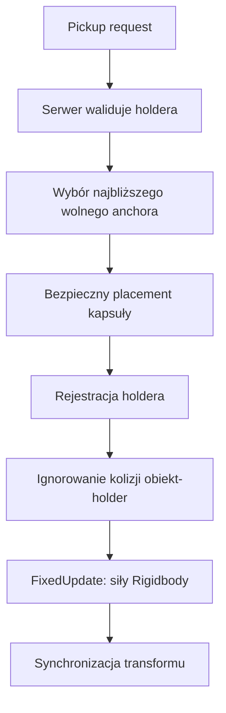

# Zasoby, przenoszenie i fizyka

## Status

**Gotowe, z rozwijanym tuningiem fizyki.** Zasoby mają trwałość, receptury
rozpadu, magazynowanie i carry. Shared-carry używa dynamicznego Rigidbody
symulowanego przez serwer.

## `BaseResourceSO`

| Pole | Znaczenie i zależności |
|---|---|
| `resourceName` | Nazwa UI i magazynów |
| `resourcePrefab` | Sieciowy prefab spawnowany przez utility/receptury |
| `icon` | HUD oraz UI fabryk |
| `impactSurfaceType` | Rodzaj audio/VFX przy trafieniu narzędziem |
| `baseResourceDestructionRecipeArray` | Dozwolone narzędzia i produkty rozpadu |
| `resourceDurability` | Początkowa trwałość |
| `movementSpeedPenalty` | Kara dla single-carry |
| `canBeCarried` | Blokuje pickup gracza/NPC; false wymusza kinematic Rigidbody bez grawitacji |
| `minAmountOfPlayersNeeded` | Minimalna obsada pozwalająca rozpocząć carry; może być niższa od docelowej obsady fizycznej |
| `allowMultipleCarriers` | Włącza shared-carry |
| `recommendedCarriers` | Docelowa obsada fizyczna: normalizuje siły, udźwig, kary understaffed i próg fully-staffed |
| `maxCarriers` | Maksymalna liczba jednoczesnych holderów; nie ogranicza liczby skonfigurowanych anchorów |
| `underStaffedPenaltyMultiplier` | Kara ruchu przy niedoborze |
| `sharedCarryUnderstaffedStaminaDrainPerSecond` | Drain staminy każdego player-holdera |
| `carryMoveSpeed` | Docelowa prędkość/intencja carry |
| `carryPlayerClearance` | Odstęp kapsuły gracza od obiektu |
| `carryAttachLocalPoints` | Jawne anchory w local space; ich liczba może być większa niż `maxCarriers`, a pusta lista uruchamia fallback geometryczny |
| `sharedCarryRotationOffsetEuler` | Absolutny offset orientacji przy pierwszym holderze |
| `carryPhysicsProfile` | Opcjonalny profil Rigidbody; null używa fallbacków komponentu |
| `furnaceFuelAmount` | Ilość paliwa dodawana do pieca |

### Receptura zniszczenia

| Pole | Znaczenie |
|---|---|
| `finalProductBaseResourceSO` | Starszy/fallbackowy pojedynczy produkt |
| `neededEquippableItemType` | Jedyny typ narzędzia akceptowany przez recepturę |
| `products` | Lista SO oraz ilości |
| `spawnOffsets` | Lokalnie skonfigurowane pozycje kolejnych produktów |
| `fallbackScatterRadius` | Scatter dla produktów bez odpowiadającego offsetu |
| `scatterSpawnOffsets` | Włącza losowość także dla jawnych offsetów |
| `spawnOffsetScatterRadius` | Maksymalne przesunięcie XYZ |
| `scatterVelocityMin/Max` | Zakres impulsu `VelocityChange` |
| `scatterUpwardBias` | Dodatnia składowa pionowa kierunku |

Scatter i impuls wylicza serwer. Kinematyczny produkt może otrzymać losową
pozycję, ale nie impuls.

Obrażenia zasobu pochodzą z `EquippableItemSO.ResourceDamage`, a nie z combat
damage przekazanego do wspólnego `IDamageable`. Jawne `resourceDamage > 0`
jest źródłem prawdy. Wartość `0` zachowuje kompatybilność starszych assetów
przez fallback `damage * 2`.

## `BaseResourceNew`

| Pole | Znaczenie |
|---|---|
| `baseResourceSO` | Typ i cała konfiguracja zasobu |
| `resourceDurability` | Stan runtime; inicjalizowany z SO |
| `isPickedUp` | Stan runtime/synchronizacji |
| `sharedCarryGroundLayerMask` | Warstwy podłoża dla placementu |
| `sharedCarryGroundRaycastUpOffset` | Początek sondy nad referencyjnym poziomem |
| `sharedCarryGroundRaycastDownDistance` | Maksymalna długość sondy w dół |
| `sharedCarryGroundClearance` | Odstęp collidera od podłoża |
| `sharedCarryGroundVerticalFollowSpeed` | Szybkość korekty wysokości |
| `sharedCarryMaxVerticalPlacementDelta` | Maksymalny teleport holdera w pionie |

`CanBeDestroyed` wynika z niepustych receptur. Produkt bez receptury nie
pokazuje promptu ataku.

## `MountableBridgeComponentSO`

`WoodenDeckPanelMountable` jest wyjątkiem od opisanych niżej profili części mostu: korzysta z `physicalPanelPlacement`, single-carry (1 carrier) i masy 1 kg. Dziedziczony profil 30 kg / recommended 2 dotyczy legacy panelu.

| Pole | Znaczenie |
|---|---|
| `componentName`, `componentSprite` | Nazwa i ikona |
| `inGameGameObjectPrefab` | Sieciowy prefab przenoszonego produktu |
| `requiredResources` | Dane kompatybilności legacy; aktywna fabryka używa `ProductionRecipeSO` |
| `bridgeComponentSO` | Typ holdera/finalnej części |
| `movementSpeedPenalty` | Kara single-carry |
| pola carrierów | Takie samo znaczenie jak w `BaseResourceSO` |
| `meltingPoint` | Parametr legacy; aktywny piec odczytuje go z `ProductionRecipeSO` |
| `combustionTemperature` | Parametr legacy; aktywny piec odczytuje go z `ProductionRecipeSO` |
| `neededProgress` | Parametr legacy; aktywny piec odczytuje go z `ProductionRecipeSO` |
| `neededCombustionProgress` | Parametr legacy; aktywny piec odczytuje go z `ProductionRecipeSO` |
| `componentWidth/Length` | Wymiary wybierane/porównywane przez stół stolarski |

`RequiredResource.resourceType` wskazuje SO, a `amount` wymaganą liczbę.

## Metalowe półprodukty

Piec produkuje cztery zwykłe `BaseResourceSO`: `Forged Nail Bundle`,
`Bolt & Nut Set`, `Connector Plate Set` oraz `Foundation Anchor Kit`.
Są dynamiczne, przenośne przez jednego gracza, nie mają receptur niszczenia i
nie są paliwem. Carpenter Table zużywa je jako składniki części nowego mostu.

Koszty produkcji, wielkości partii oraz parametry temperatury znajdują się w
`ProductionRecipeSO`, opisanym w
[Factories-Storage-And-Production](Factories-Storage-And-Production.md).

## Single-carry

Single-carry obejmuje wyłącznie obiekty skonfigurowane do tego trybu: między innymi `BaseResourceNew`, `MountableBridgeComponent` implementujące `ISingleCarryPlaceable` oraz wiadro. Nie obejmuje narzędzi z inventory, obiektów `Shared-carry` (także z jednym holderem), przenoszenia graczy ani interakcji z obiektami self-positioned lub flexible sapling. Podniesiony obiekt zachowuje dotychczasowy pojedynczy uchwyt, visual/anchor i karę ruchu; gracz nadal używa `CharacterController`.

### Fizyczne płyty mostu — Etap 1 (zaakceptowany 2026-10-17)

`WoodenDeckPanelMountable` używa jawnej flagi `physicalPanelPlacement`, jest single-carry dla jednego carriera, ma stałą geometrię `2.16 × 0.20 × 2.40 m` i zachowuje masę spoczynkową Rigidbody `1 kg`. Zwykłe E wyszukuje wolną pozycję przed graczem w zasięgu interakcji (domyślnie `2.5 m`), uwzględniając rozmiar płyty, holdera i przeszkody. Jeśli nie ma bezpiecznego miejsca, obiekt pozostaje w rękach, a ownership się nie zmienia; klient zwalnia lokalnie dopiero po akceptacji serwera. Zachowany jest zwykły rzut `VelocityChange` `1.5 m/s`; F/E/Esc w workflow placementu i obrót nie dodają tego impulsu. Zmiana dotyczy wyłącznie fizycznych płyt, pozostałe przedmioty i gwoździe zachowują dotychczasowe zachowanie.

Cztery lookupi pickup/release w `MountableBridgeComponent` korzystają z instancyjnego `NetworkManager`. Test host+zdalny owner używa NGO/UTP loopback w jednym procesie; nie sprawdza osobnego procesu klienta ani WAN/Relay. Offline ActualFAndECommit oraz testy NGO jawnie ustawiają `placementDistance=5f`, więc domyślny dystans wymaga ręcznego odbioru. Historyczny unfiltered Gameplay Etapu 1 przeszedł 14/14 kroków (EditMode 104/104, PlayMode 115/115, analyzer 921/316, zero nowych): [raport](D:/Programy/UnityProjects/RageQuitting/Artifacts/Validation/20261017T180307Z-54056cce/summary.json). Ręczny status i checklista są w [Mounting-Nails](Mounting-Nails.md#fizyczne-płyty--etap-1).

### Porządkowanie sceny fixture gwoździ i płyt (19.10.2026)

Użytkownik potwierdził, że poprawka fizycznych paneli działa, po czym poprosił o usunięcie dodanych rekwizytów scenicznych poza nowymi gwoździami i panelami, z zachowaniem potrzeb testów. Porządkowanie zostało wykonane i przeszło walidację techniczną; nie odnotowano osobnej wizualnej akceptacji tej zmiany. W scenie gameplay `Assets/Experiments/TutorialTerrainStage02/Scenes/TutorialTerrainStage02.unity` pod `BridgeAssemblySupplies` zachowano 48 gwoździ i 3 fizyczne panele z dawnego obszaru testowego; te liczby opisują retained fixture, nie wszystkie supplies/panele w scenie. Poza tym zestawem istniejące supplies i panele sceny pozostały nietknięte. Zachowano tożsamości GlobalObjectId i prefaby oraz pozycje XZ, obroty i skale; jedyna korekta pozy to `FixtureNail_28`, podniesiony o `0.029617 m` (Y `0.040000` → `0.069617`) po wykryciu nakładania kapsuły z terenem. Test kapsuł potwierdził zero pozostałych penetracji gwoździ w zewnętrzne bryły. Pozostałe testowe plansze, dźwigary, powierzchnie, młot, markery i sondy przeniesiono do `Assets/Tests/Fixtures/MountingNailTestScene.unity` (korzeń `NailTestArea`), poza Build Settings. `MountingNailTestAreaAuthoring` i `BridgeDeckPanelTestAreaAuthoring` kierują authoring do tej dedykowanej sceny; zależne EditMode testy wczytują disposable preview scenes i tymczasowe fixture clones. Produkcyjny validator nadal sprawdza główny most i nie wymaga fixture w gameplay. Scena archiwalna służy testom/authoringowi, nie została zweryfikowana jako samodzielna scena gry ani network bootstrap. Główne sloty, dźwigary, manager/runtime records, receptury i mechaniki pozostały bez zmian.

Końcowy strict, nieprzefiltrowany Gameplay preflight z 19.10.2026: `passed`, exit 0, 14/14 kroków; EditMode 124/124 i PlayMode 125/125, bez błędów, pominięć ani inconclusive. Analyzer 921 wystąpień/316 grup wobec niezmienionego baseline 925/316, bez nowych diagnostyk; source hash guard 0 mutacji. Console po przebiegu: 0 błędów i 11 ostrzeżeń, wszystkie teksty ostrzeżeń wystąpiły w stanie sprzed porządkowania (porównanie po treści komunikatu). Przed cleanup Console miała 1 znany błąd procesu Unity AI Assistant Relay i 14 ostrzeżeń; po przebiegu błąd nie wystąpił, ale Console nie była jawnie czyszczona ani pakiet naprawiany, więc nie uznajemy tego za naprawę Relay. Wcześniejsze niepowodzenia EditMode pochodziły ze stale skompilowanej DLL; wymuszony import/kompilacja i świeża DLL poprzedziły wynik 124/124 — szczegóły w [checkpoint](D:/Programy/UnityProjects/RageQuitting/Artifacts/SceneCleanup_20261019/Validation/worker-checkpoint.md). [Raport Gameplay](D:/Programy/UnityProjects/RageQuitting/Artifacts/Validation/20261019T170036Z-f1193b3e/summary.json), [audyt zachowanych rekordów sceny](D:/Programy/UnityProjects/RageQuitting/Artifacts/SceneCleanup_20261019/Validation/scene-record-review.json), [porównanie Console](D:/Programy/UnityProjects/RageQuitting/Artifacts/SceneCleanup_20261019/Validation/console-comparison.json), [audyt korekty gwoździa](D:/Programy/UnityProjects/RageQuitting/Artifacts/SceneCleanup_20261019/Before/nail-correction-audit.txt), [audyt archiwum fixture](D:/Programy/UnityProjects/RageQuitting/Artifacts/SceneCleanup_20261019/Before/archive-audit.txt). Walidacja fixture objęła prefab links, identities, NetworkObject hashes i wykluczenie z Build Settings, lecz nie samodzielne uruchomienie tej sceny ani osobny proces klienta, WAN/Relay lub player build.

### Follow-up geometrii płyt i prześwitu przy przyczółkach (19.10.2026)

Skrócono fizyczny panel wzdłuż mostu z historycznych `2.64 m` do `2.16 m` (wymiary X/Y/Z: `2.16 × 0.20 × 2.40 m`; masa `1 kg`). Model, profil, obrys i collider są zgodne; skala korzenia wynosi `1` i runtime nie skaluje produktu. Główne sloty i fixture mają środki lokalnego X `-2.20/0/+2.20 m`, rozpiętość `6.56 m` i nominalne szczeliny `4 cm`. W głównym moście sloty przesunięto po `48 cm` do środka, co daje nominalnie `12 cm` prześwitu do wewnętrznych krawędzi rzeczywistych przyczółków przy X `±3.4 m` (zewnętrzne krawędzie paneli przy `±3.28 m`). Główne sloty mają local Y `0.095` (światowe `1.425 m`) zgodnie z rzeczywistą wysokością podparcia collidera; widoczny wierzch siatki belki jest na `1.400 m`. Fixture używa innych, ogólnych dźwigarów i zachowuje local Y `0.275`. Fizyczne dźwigary długości `8 m`, ich collidery, ogólny prefab sekcji `14 m` z siedmioma slotami, przyczółki oraz reguły tolerancji, ćwiartek, gwoździ, carry, resetu, sieci i receptur pozostały bez zmian. Istniejące panele zachowują pozycje i dziedziczą nowy rozmiar.

Strict unfiltered Gameplay z 19.10.2026: `passed`, exit 0, 14/14 kroków; EditMode 123/123 i PlayMode 125/125, bez błędów, pominięć ani inconclusive. Oba nowe testy prześwitu przy przyczółku przeszły dla orientacji `0°/180°` oraz podparcia fixture. Analyzer: 921 wystąpień/316 grup wobec niezmienionego baseline 925/316, bez nowych diagnostyk; source hash guard wykrył 0 mutacji. Console po przebiegu: 0 błędów i 11 ostrzeżeń; porównanie wyłącznie po tekście komunikatu znalazło wszystkie ostrzeżenia w Console sprzed zmiany. Console nie była jawnie czyszczona, a zwykły cykl Play może resetować log. [Raport Gameplay](D:/Programy/UnityProjects/RageQuitting/Artifacts/Validation/20261019T140756Z-64ae9443/summary.json), [checkpoint i zakres ręcznej akceptacji](D:/Programy/UnityProjects/RageQuitting/Artifacts/DeckPanelAbutmentClearance_20261018/Validation/Resume_20261019/review-checkpoint.json), [audyt geometrii sceny](D:/Programy/UnityProjects/RageQuitting/Artifacts/DeckPanelAbutmentClearance_20261018/Validation/Resume_20261019/review-layout.json), [porównanie Console](D:/Programy/UnityProjects/RageQuitting/Artifacts/DeckPanelAbutmentClearance_20261018/Validation/Resume_20261019/console-comparison.json).

Ukierunkowane wywołanie Pipeline run_tests z 18.10.2026 zakończyło się timeoutem narzędzia po 240000 ms i kodem CLI 1 bez zapisanego surowego wyniku; nie było zaliczonym testem. Zastępuje ją powyższy pełny przebieg z 19.10.2026. Nie wykonano osobnego procesu klienta, WAN/Relay ani player buildu; istniejące testy NGO używały lokalnych peerów w jednym procesie, a network smoke jest host-only. Użytkownik potwierdził, że poprawka fizycznych paneli działa. Porządkowanie sceny zostało wykonane na jego prośbę i technicznie zwalidowane; nie ma osobnej wizualnej akceptacji tej zmiany. Nie zgłaszał osobnej weryfikacji każdego scenariusza Etapu 4. Ograniczenia dotyczące osobnego procesu klienta, WAN/Relay i player buildu pozostają takie, jak opisano wyżej.

### Fizyczne płyty mostu — Etap 2 (zaakceptowany 2026-10-18)

`WoodenDeckPanelMountable` zachowuje wymiary `2.16 × 0.20 × 2.40 m`, pivot na spodzie (`Y=0`) i masę `1 kg`. Aktualny profil ocenia niezależnie przesunięcie wzdłuż slotu `0.05 m` i w poprzek `0.10 m`; profile bez włączonych oddzielnych tolerancji zachowują starszy radialny limit `0.05 m`. Wysokość to `0.03 m`, a rotacja do `3°` względem pozy bazowej lub `Y=180°`. Etap 2 obejmuje też cztery niezależne ćwiartki mocowane gwoździami `EmbeddedPair` do jawnie wskazanych głównych dźwigarów tej samej sekcji. Ukończenie lokalne wymaga czterech różnych ćwiartek, poprawnej pozy, wolnego slotu oraz przenikania do `1 mm`; replikuje się także late join. F centrowane jest na trafionym punkcie, więc pusta przestrzeń między dźwigarami nie podtrzymuje panelu. Bazowy Etap 2, wcześniejsza korekta HUD/kolorowej ramki oraz follow-up prowadzenia perspektywicznego F/E zostały ręcznie zaakceptowane 18.10.2026. Po zgłoszeniu odlatywania początkowej, niepodnoszonej płyty skorygowano kolejność inicjalizacji jej fizyki: po `OnNetworkPostSpawn` niepodniesiona płyta serwerowa ma ponownie ustawioną fizykę zrzuconego obiektu, a zaakceptowany reset przywraca grawitację. Najnowszy strict Gameplay po poprawce przeszedł 14/14 kroków (EditMode 117/117, PlayMode 121/121), analyzer 921 wobec baseline 925/316 bez nowych diagnostyk ([raport](D:/Programy/UnityProjects/RageQuitting/Artifacts/Validation/20261018T172716Z-cc135b9e/summary.json)); aktualny status ręczny opisuje [Mounting-Nails](Mounting-Nails.md#fizyczne-płyty--etap-3). Użytkownik zaakceptował poprawkę grawitacji i reset Etapu 3 na hoście oraz kliencie. Wcześniej przekazany zakres odbioru resetu i ochrony ukończenia pozostaje w tym historycznym wpisie. Etap 4 jest wdrożony; jego ręczny odbiór i ograniczenia sieciowe opisuje [Mounting-Nails](Mounting-Nails.md#fizyczne-płyty--etap-4). Etap 1 został ręcznie zaakceptowany 17.10.2026 („Wydaje się, że wszystko działa”); szczegóły i ograniczenia testów opisuje [Mounting-Nails](Mounting-Nails.md#fizyczne-płyty--etap-2).
### Ustawianie obiektu (etapy 1–6; stan na 2026-10-10)

- `F` włącza tryb dla trzymanego, obsługiwanego obiektu. `E` zatwierdza poprawne ustawienie, `Esc` anuluje. W trybie blokowane są chodzenie, sprint, skok i pozostałe akcje gameplay; obrót kamery pozostaje aktywny, podobnie jak grawitacja i impulsy fizyczne. Wejście do trybu zeruje lokalny obrót obiektu.
- Podgląd to przezroczysty renderer-only ghost, bez fizyki i komponentów gameplay. Właściciel widzi go natychmiast, a serwer przekazuje stan podglądu pozostałym osobom w lobby z częstotliwością do 20 Hz; późne dołączenie otrzymuje aktualny stan. Model trzymanego obiektu ukrywany jest wyłącznie lokalnie u właściciela. Ghost jest sprzątany przy wyjściu z trybu i zmianach cyklu życia sieci.
- Zasięg ustawiania wynosi 2 m i jest niezależny od zasięgu interakcji. Promień celowania używa tego samego punktu początkowego co interakcje. Gdy promień nie trafi przeszkody, ghost pojawia się na jego końcu. Pierwsza trafiona przeszkoda wyznacza powierzchnię, a geometria obróconych colliderów obiektu dopasowuje jego pozycję do tej powierzchni.
- Strzałki góra/dół obracają wokół lokalnej osi X, lewo/prawo wokół lokalnej osi Z z prędkością 90°/s; obrót jest ciągły i pozwala wykonać pełny obrót. Yaw kamery wyznacza bazę ustawienia, a pitch przesuwa celowaną pozycję.
- Zielony/czerwony ghost pokazuje wynik sprawdzenia zajętości względem świata, własnego i pozostałych graczy, NPC oraz ruchomych obiektów. Zapytania ignorują źródłowy obiekt, ghost i triggery. Zwykły kontakt bez penetracji jest dozwolony. Nie ma fizycznego ghosta, przyciągania ani siatki.
- Poza sesją sieciową zatwierdzenie ponownie sprawdza zajętość lokalnie, po czym zwalnia obiekt w dokładnej pozycji i rotacji oraz przywraca normalną fizykę. W sesji NGO klient przesyła referencję źródła, pozycję, rotację, promień celowania i monotoniczny identyfikator żądania; host wykonuje tę samą ścieżkę autorytatywną lokalnie, a klient-serwer wysyła RPC.
- Serwer przed zmianą stanu trzymania sprawdza połączonego holdera, konfigurację i stan obiektu, anchor promienia, najnowszą pozycję gracza, limit 2 m, wspólną geometrię oraz aktualną zajętość. Początek promienia może leżeć do 0,2 m od znanego anchoru w kierunku promienia (np. przy near clip kamery); pozostała rozbieżność jest ograniczona do 0,15 m. Dla legacy/static/free-world ścieżki żądana pozycja świata musi zgadzać się z wyliczoną z tolerancją 2 mm, a rotacja do 0,1°. Dla ścieżki zakotwiczonej do `NetworkObject` serwer porównuje wyliczoną geometrię z pozą świata odtworzoną z zapisanej pozy i orientacji względem tego samego celu (2 mm / 0,1°). Serwer nie odtwarza `Camera.main` zdalnego klienta.
- Przed zatwierdzeniem serwer ponawia zapytanie kolizji, przekazuje własność serwerowi, wykonuje `NetworkTransform.Teleport` do zaakceptowanej pozycji i rotacji oraz zeruje prędkość. Pomija zwykły impuls odsunięcia przy dropie; obiekt następnie podlega normalnej fizyce, może spaść i przewrócić się.
- Podczas oczekiwania na odpowiedź ghost jest zamrożony; kamera nadal działa, a `E`, `F` i `Esc` czekają na wynik. Akceptacja kończy tryb. Odmowa pozostawia obiekt w rękach i tryb edycji aktywny oraz pokazuje zwięzły komunikat. Menu, downed, wyłączenie wejścia, utrata obiektu, zmiana kanału lub sceny, despawn i rozłączenie wymuszają sprzątanie; spóźniona odpowiedź jest ignorowana.

Etap 6 uwzględnia collidery własnego gracza przy sprawdzaniu zajętości. Poprawka obsługująca placement zdalnego gracza bez lokalnego `PlayerSingleCarryPlacementController` została ręcznie zaakceptowana przez użytkownika na desce w `TutorialTerrainScene2` w Multiplayer Play Mode. Zasięg 2 m jest konfigurowany na `PlayerSingleCarryPlacementNetworkPreview`, obecnym na wszystkich peerach; kontroler lokalny korzysta w sesji NGO z tego samego ustawienia, a offline zachowuje fallback 2 m. Serwer dopuszcza początek promienia w ograniczonym odcinku 0,2 m od znanego anchora, z residualną tolerancją 0,15 m, bez rekonstruowania `Camera.main` klienta. Pozostałe kontrole holdera, konfiguracji, stanu, własności, źródła i zajętości oraz tolerancje pozycji 2 mm i rotacji 0,1° pozostają aktywne.

Końcowy strict, unfiltered Gameplay preflight zakończył się statusem `failed` i kodem 1 wyłącznie przez analyzery. Wykryto 936 wystąpień w 326 grupach wobec baseline 925/316; niezależne porównanie z pre-followup stanem wykazało zero nowych fingerprintów ani wzrostów liczności (dwa wystąpienia UNT0008 mniej). Kompilacja, Console, EditMode (94/94), PlayMode (37/37), walidatory, scenariusz gameplay, network smoke i mutation guard przeszły. Raport: `Artifacts/Validation/20261010T152838Z-09598710/summary.json`. Preflight nie zakończył się pełnym sukcesem z powodu analyzer ratchet.

### Uzupełnienia wdrożone po etapie 6 — oczekuje ręczna weryfikacja

- `BaseResourceNew` i `MountableBridgeComponent` ustawiają `DontDestroyWithOwner` dla światowych NetworkObjectów już w `Awake`; pozostają własnością serwera po rozłączeniu klienta. Przy `PlayerObject.OnNetworkDespawn` ekwipunek przechwytuje po stronie serwera pozycję gracza i zreplikowane dwa sloty przed deinicjalizacją NGO. W callbacku rozłączenia zwalniane są trzymane obiekty świata, przywracane są ignorowane kolizje, a mapowania rozłączonego holdera są usuwane, a obiekt ostatniego holdera wznawia fizykę w dotychczasowej pozycji serwera z zerową prędkością początkową i `NetworkTransform.Teleport`. Jeśli klient odłącza się z narzędziami w ekwipunku, sloty są upuszczane raz w pobliżu ostatniej znanej pozycji gracza z użyciem zwykłej fizyki dropu; puste lub zarezerwowane sloty są pomijane, a dwuslotowe narzędzie nie jest duplikowane. Zrzut nie jest tworzony przy zwykłym despawnie gracza ani podczas zamykania serwera. Wspólny obiekt pozostaje niesiony, gdy zostaje inny holder; lokalny test NGO/UTP potwierdził przetrwanie holdera hosta, gdy rozłączył się drugi gracz trzymający `Wooden Log`. Ręczna weryfikacja przez użytkownika nadal oczekuje: osobno rozłączenie klienta niosącego deskę i dwa jednoslotowe narzędzia (`Axe` oraz `Pickaxe`), a w osobnej próbie deskę i jedno narzędzie dwuslotowe (`IndustrialHammer`, upuszczone tylko raz). Osobno należy sprawdzić przeżycie obiektu shared-carry, gdy pozostaje drugi holder.
- Ghost obserwatora płynnie podąża w każdej renderowanej klatce do ostatniego snapshotu: pozycja interpoluje liniowo, a rotacja przez najkrótszy łuk `Quaternion.Slerp`, domyślnie przez 50 ms. Nie ma ekstrapolacji; właściciel nadal widzi natychmiastową pozycję, a wysyłanie snapshotów pozostaje do 20 Hz. Pierwszy rozpoznany lub nowy obiekt i ghost późno dołączającego obserwatora pojawiają się od razu. Kolor ważności aktualizuje się po otrzymaniu stanu, a polling wyglądu i identyczne snapshoty nie restartują interpolacji. Po zakończeniu pozycja i rotacja osiągają dokładny cel; anulowanie i cleanup cyklu życia zerują stan interpolacji i usuwają ghost. Ręczna weryfikacja nadal oczekuje dla ruchu, obrotu, koloru, anulowania i natychmiastowego podglądu właściciela.

Testy tych uzupełnień używają lokalnej pętli NGO/UTP z rzeczywistymi prefabami narzędzi (`Axe`, `Pickaxe`, `IndustrialHammer`) i `Wooden Log`, a także syntetycznymi fixture zasobu single-carry i obiektu mountable. Kopie testowe izolują wejście i fizykę; pickup oparty o legacy Singleton RPC wymaga specjalnego harmonogramowania testu. Testy ghosta sprawdzają pośrednie klatki interpolacji, krótki łuk rotacji, kolor podczas ruchu, polling wyglądu, dokładne zatrzymanie oraz anulowanie i ponowne wejście; w wybranych testach czas jest wydłużany do 0,8 s, przy osobnym sprawdzeniu wartości domyślnej 0,05 s. Nie potwierdzono multiplayer builda, osobnego procesu klienta ani WAN/Relay; testy nie zastępują powyższej ręcznej weryfikacji.

### Poprawki placementu i kolizji single-carry — 2026-10-12

Zatwierdzenie F/E klienta przechowuje referencję wybranego celu oraz lokalną pozę i kontakt z tej samej renderowanej klatki podglądu. Przy obsłudze żądania serwer rozwiązuje tę samą instancję `NetworkObject` i fizyczny root, przelicza pozę względną oraz weryfikuje zaufany origin, zasięg, widoczność, kontakt i zajętość. Cel może poruszyć się lub obrócić oraz opuścić pierwotny promień; cele bez `NetworkObject` nadal używają ścieżki legacy o ścisłej pozycji świata. Odmowa nie upuszcza obiektu i pozwala ponowić próbę.

Podczas pojedynczego carry `BaseResourceNew` i `MountableBridgeComponent` ustawiają na każdym solidnym colliderze `excludeLayers = AllLayers` z najwyższym `layerOverridePriority`. Collider pozostaje włączony i dostępny dla raycastów celowania, kontroli kontaktu oraz zajętości; zapisane maski i priorytet są przywracane przy release i cyklu życia. Serwerowa trwała flaga `NetworkVariable` synchronizuje stan z ownerem, obserwatorami i late join; shared-carry nie zmienia zachowania. Poprawka obejmuje prefab gracza, deskę i gwóźdź oraz obiekty z Rigidbody i CharacterController w lokalnych testach.

Finalny strict Gameplay preflight z 2026-10-12: [summary](D:/Programy/UnityProjects/RageQuitting/Artifacts/Validation/20261012T135505Z-2033f7af/summary.json). EditMode 96/96 i PlayMode 78/78 przeszły; finalne testy SingleCarry: [PlayMode report](D:/Programy/UnityProjects/RageQuitting/Artifacts/Validation/UnityPlayMode/20261012T135236Z-7e83f371/unity-playmode-tests-report.json), 30/30. Cały preflight ma status `failed` (kod 1) wyłącznie przez analyzer ratchet: 936 wobec baseline 925, dziesięć nowych grup tylko w istniejących plikach SRP samples i zero nowych diagnostyk tasku; baseline nie zmieniono. Network-smoke jest host-only; testy NGO używają lokalnej pętli i izolowanych colliderów lustrzanych. Nie potwierdzono niezależnego procesu klienta ani WAN/Relay.

Użytkownik ręcznie sprawdził poprawki placementu i kontaktu single-carry, potwierdził, że działają, i zezwolił na Etap 3 gwoździ. Pozostałe starsze checklisty w tej dokumentacji dotyczą osobnych prac (disconnect cleanup, carry ghost/interpolacja i inne carry behavior) i zachowują własny status ręcznej weryfikacji. Przy placement F/E ghost nadal jest world-space. Dla tego patcha zatwierdzenie serwera rebazuje kontakt i pozę względem tego samego NetworkObject celu oraz ponownie sprawdza kontakt i zajętość. Dla celów bez `NetworkObject` sam protokół placementu nadal wymaga ścisłej pozycji świata. Etap 3 gwoździ dodaje osobno trwałą tożsamość celu i serwerowe podążanie osadzonego gwoździa za celem; podgląd ghost pozostaje world-space.

Etap 3 gwoździ dodaje sieciowy stan `EmbeddedPair` i `RequiredHitsForTwoObjects=3`; pojedynczy obiekt wymaga 1 trafienia. Zasięg i końcowa głębokość wynoszą 0,30 m. Pierwsze trafienie zapamiętuje oryginalną parę. Po pierwszym i drugim trafieniu cele pozostają niezależne; dopiero trzecie ponownie waliduje parę i tworzy połączenie. Pośrednie trafienia nie sprawdzają drugiego celu. Jeśli przy finale którykolwiek cel jest niesiony lub drugi cel jest poza kontaktem, zablokowany albo usunięty, gwóźdź wraca do `EmbeddedSingle` na pierwszym celu, bez jointa i bez substytucji.

Po finale serwer tworzy jeden `FixedJoint` na nieuporządkowaną parę, z progami zerwania ustawionymi na nieskończoność, jeśli co najmniej jeden cel ma Rigidbody. Statyczny cel bez Rigidbody jest kotwicą świata; dwa statyczne cele bez Rigidbody tworzą logiczne połączenie i blokadę pickup bez jointa. Kilka niezależnych gwoździ tej samej pary współdzieli jeden joint; trzy obiekty tworzą łańcuch. Serwer zarządza jointami i własnością połączonej fizyki; late join otrzymuje stan. Pin blokuje pickup obu celów przez gracza/NPC; pierwszy cel można podnieść w stanie częściowym. Aktorów nie łączy się gwoździami, pozostają celami `EmbeddedSingle`. Usunięcie pierwszego celu usuwa gwóźdź także w stanie częściowym. Utrata drugiego celu rozstrzyga się dopiero przy finale i cofa gwóźdź do `EmbeddedSingle` na pierwszym celu; niesienie dowolnego celu przy finale daje ten sam wynik. Po utworzeniu krawędzi utrata pierwszego celu usuwa gwóźdź, a drugiego cofa go do pojedynczego wbicia. Usunięcie ostatniego gwoździa danej krawędzi usuwa połączenie tej pary. Blokada pickup danego celu znika dopiero, gdy nie ma on innych krawędzi w łańcuchu. Ownership NetworkObject wraca dopiero, gdy żaden jego fizyczny root nie ma połączenia. Flagi fizyki celu NoNI pozostają w trybie follow, jeśli nadal śledzi go inny `Partial`/`Single` gwóźdź; są przywracane dopiero przy braku połączeń i follow. Obejmuje to bramki podnoszenia `BaseResourceNew`, `MountableBridgeComponent`, gracza/NPC oraz equippable inventory.

NoNI używa wypieczonego `UnityEditor.GlobalObjectId` (GUID assetu sceny i trwały identyfikator obiektu). NI używa bieżącego `NetworkObjectId` spawnu oraz `PhysicalRootPath` z indeksami rodzeństwa pod NetworkObject; ta ścieżka dotyczy wyłącznie NI. Pierwszy cel NoNI podąża za serwerową pozą od pierwszego trafienia, a licznik follow jest niezależny od blokady pickup. Kopiowanie obiektu sceny wymaga ponownego wypieczenia ID. Produkty runtime wymagają NetworkObject lub przyszłej integracji fabryki.

Etap 3 został ręcznie zaakceptowany 15.10.2026. Etap 4 i poprawki follow-upu podglądu F/E na poruszanym celu oraz zwykłego rzutu E zostały ręcznie sprawdzone; użytkownik potwierdził „Okej, poprawki działają”. Trafienie `IndustrialHammer` w luźny gwóźdź dodaje do bieżącej prędkości gwoździa 1 m/s poziomo od gracza (wartość domyślna) i 0,25 m/s w górę, bez przygotowania ani obrażeń; `Partial` kontynuuje osadzanie, a ukończony gwóźdź pozostaje zamontowany. Zwykłe E poza trybem F wykonuje łagodny rzut do przodu, domyślnie 1,5 m/s. Szczegóły, konfigurację i checklistę host/klient opisuje [Mounting-Nails](Mounting-Nails.md).

Nowe testy uruchamiają hosta, klienta zdalnego i klienta dołączającego później w jednym procesie loopback UTP. Wykorzystują gwóźdź 0,1 kg i testową deskę 20 kg oraz sprawdzają masę po zwolnieniu; konfiguracja gracza 2,25 m/s potwierdza wartość inną niż domyślna. Testy sprawdzają RPC, ścieżkę hosta, autorytet i odrzucenie powtórzonego żądania. Snapshot dotyczy zatrzymanego przedmiotu. Nie potwierdzają osobnego procesu klienta, buildu ani WAN; ogólny network-smoke jest host-only (peerCount 1, remoteClientValidated false, Relay false). Zakres tych testów jest odrębny od historycznych testów Etapu 4 z czterema uczestnikami.

Historyczny raport Etapu 4 sprzed poprawek: [summary](D:/Programy/UnityProjects/RageQuitting/Artifacts/Validation/20261015T173521Z-cdc6e8b2/summary.json). Status `failed`, kod 1 wyłącznie przez analyzer ratchet: 936/326 wobec chronionego baseline 925/316; wszystkie pozostałe kroki przeszły bez pominięć, w tym EditMode 101/101 i PlayMode 103/103. Porównanie fingerprintów i liczników ze Stage 3 wykazało deltę 0, baseline bez zmian. Targeted Etap 4: [summary](D:/Programy/UnityProjects/RageQuitting/Artifacts/Validation/20261015T173245Z-078d2c35/summary.json), EditMode 7/7 i PlayMode 49/49; tylko analyzer nie przeszedł. Dwa rozszerzone testy NGO PlayMode sprawdzają hosta, zdalnego ownera, pierwotnego obserwatora i czwartego klienta late join w jednym procesie loopback UTP; kontakty lustrzane i grawitacja są izolowane, a prędkość gwoździa zatrzymywana przed automatycznym sprawdzeniem late-join pozy. Ogólny network-smoke jest host-only (peerCount 1, remoteClientValidated false, Relay false). Nie potwierdzono osobnego procesu klienta, buildu, WAN ani Relay. Szczegóły zachowania i checklistę ręcznego odbioru zawiera [Mounting-Nails](Mounting-Nails.md).

Historyczny końcowy strict Gameplay po follow-upie (2026-10-15): [summary](D:/Programy/UnityProjects/RageQuitting/Artifacts/Validation/20261015T191713Z-b6f585f6/summary.json). Status `failed`, kod 1 wyłącznie przez analyzers; wszystkie pozostałe kroki przeszły bez pominięć, w tym compile, Console, EditMode 101/101, PlayMode 106/106, validators, gameplay-scenario, network-smoke i mutation guard. Analyzer: 936 wystąpień/326 grup wobec chronionego baseline 925/316; fingerprinty i liczniki identyczne z raportem Etapu 4 sprzed poprawek (delta 0), baseline bez zmian. Targeted follow-up: [summary](D:/Programy/UnityProjects/RageQuitting/Artifacts/Validation/20261015T191425Z-6c638452/summary.json), EditMode 7/7, PlayMode 33/33; tylko analyzer nie przeszedł.

### Walidacja gwoździ i próbek SRP — 2026-10-16

Końcowy strict, unfiltered Gameplay preflight zakończył się statusem `passed`, kodem `0`; wszystkie 14 kroków przeszły, EditMode 101/101 i PlayMode 106/106. [Raport](D:/Programy/UnityProjects/RageQuitting/Artifacts/Validation/20261016T152055Z-4a19af9b/summary.json). Analyzer: 921 wystąpień/316 grup wobec chronionego baseline 925/316, bez nowych diagnostyk; baseline i reguły pozostały bez zmian.

Usunięto wyłącznie `Assets/Samples/Scriptable Render Pipeline Core` oraz `Assets/Samples/Scriptable Render Pipeline Core.meta`; zawartość obejmowała tylko `17.3.0/Common`. Pakiety URP/SRP 17.3.0 pozostały bez zmian. Usunięcie wyeliminowało 15 nowych wystąpień w 10 grupach; cztery starsze wystąpienia były już rozwiązane, stąd poprzedni wzrost netto 11. Backup 103 assetów: [srp-core-common-before-removal.unitypackage](D:/Programy/UnityProjects/RageQuitting/Artifacts/SrpSampleRemoval20261016/srp-core-common-before-removal.unitypackage).

Pierwsza próba eksportu kopii zapasowej przez CLI przekroczyła limit 5 s, ale powstałe archiwum zostało zweryfikowane. Pierwsza próba Gameplay zatrzymała się na Console z powodu `[Package Manager Window] Operation cancelled`, więc dalsze testy nie ruszyły ([raport](D:/Programy/UnityProjects/RageQuitting/Artifacts/Validation/20261016T151933Z-0dcba3b1/summary.json)). Pełne logi Console zapisano przed jej wyczyszczeniem. Po sprawdzeniu Package Manager, wyczyszczeniu Console i bez zmian baseline końcowy przebieg przeszedł.

Ograniczenia pozostają: network-smoke host-only (peerCount 1, remoteClientValidated false, Relay false), a testy NGO używają loopback w jednym procesie. Nie potwierdzono osobnego procesu/builda klienta, WAN ani Relay.

## Shared-carry

- System sprawdza wszystkie wolne anchory według odległości od `BodyAnchor`.
- Jeśli najbliższy placement jest zablokowany, próbuje kolejnych.
- Pierwszy holder prostuje obiekt do yaw i stosuje rotation offset SO.
- Holderzy nie kolidują z własnym obiektem; osoby postronne i świat nadal tak.
- `DirectYaw`: W/S wysyła centralną translację, a A/D osobny input yaw.
- `PhysicalPointGrip`: siły są przykładane w punktach chwytu, a A/D generuje
  fizyczną siłę boczną i wynikający z miejsca chwytu moment. Wysokość anchora
  jest stała i nie zależy już od pitch kamery.
- `Wooden Log` oraz sześć aktualnych części mostu używają `PhysicalPointGrip`.
  Każdy rodzaj części ma osobny profil dostrojony do swojej geometrii i masy.
- NPC shared-carry jest obecnie wyłączony globalnym feature gate, ale kod
  pozostaje.

### Profile i anchory części mostu

| Część | Profil | Masa | Max angular velocity | Max tilt | Lift/carrier |
|---|---|---:|---:|---:|---:|
| Wooden Foundation | `CarryPhysicsProfile_WoodenFoundationPhysical` | 45 | 1.1 | 35° | 0.38 |
| Wooden Abutment | `CarryPhysicsProfile_WoodenAbutmentPhysical` | 60 | 1.0 | 32° | 0.38 |
| Wooden Main Girder | `CarryPhysicsProfile_WoodenMainGirderPhysical` | 70 | 0.65 | 28° | 0.38 |
| Wooden Cross Beam | `CarryPhysicsProfile_WoodenCrossBeamPhysical` | 24 | 1.2 | 42° | 0.55 |
| Wooden Diagonal Bracing | `CarryPhysicsProfile_WoodenDiagonalBracingPhysical` | 18 | 1.35 | 48° | 0.55 |
| Wooden Deck Panel (legacy/shared carry) | `CarryPhysicsProfile_WoodenDeckPanelPhysical` | 30 | 0.9 | 35° | 0.55 |

Wiersz panelu dotyczy wyłącznie legacy workflow; nowy `WoodenDeckPanelMountable` nie korzysta z tego 30 kg shared-carry. Jest osobnym single-carry produktem: 1 kg Rigidbody, jeden carrier, stała geometria `2.16 × 0.20 × 2.40 m`.

W aktualnej konfiguracji testowej wszystkie sześć części ma
`minAmountOfPlayersNeeded = 1`, więc pickup jest możliwy solo. Wartość
`recommendedCarriers` pozostaje docelowa: `3` dla Foundation, Abutment i Main
Girder oraz `2` dla Cross Beam, Diagonal Bracing i Deck Panel. Pojedynczy holder
jest zatem obsadą niedoborową i nie uruchamia stabilizacji fully-staffed. Dla
nowego produktu `WoodenDeckPanelMountable` wartości te nie mają zastosowania;
shared-carry panelu pozostaje wyłącznie legacy.

Każda z tych części ma osiem jawnych `carryAttachLocalPoints`: cztery narożniki,
a następnie środki przedniego, prawego, tylnego i lewego boku. Indeksy są
deterministyczne, a serwer przydziela najbliższy wolny i bezpieczny punkt.
Liczba punktów nie zwiększa `maxCarriers`.

Standardowe części mają logiczne anchory odsunięte o około `0.60 m` od obrysu
collidera. `Wooden Abutment` używa offsetu `0.90 m` i wspólnej wysokości
`Y = 0.30 m`, aby kapsuła gracza pozostawała poza pochyłym modelem rampy.
Preview jest rzutowane na powierzchnię visuala, natomiast fizyczna siła chwytu
na powierzchnię collidera; logiczny offset gracza nie zwiększa więc sztucznie
momentu obrotowego.

Po osiągnięciu `recommendedCarriers` sześć profili części mostu uruchamia
serwerowy solver rozkładu udźwigu. Solver rozdziela ciężar między zajęte anchory,
minimalizuje moment pitch/roll i respektuje `pointGripLiftCapacityPerCarrier`.
Pasywny moment jest liczony z finalnej siły chwytu po wygładzaniu i limitach, a
nie tylko z nominalnego podparcia grawitacji. Kompensacja rollu wokół długiej osi
jest aplikowana dokładnie raz; stabilizacja pełnej obsady otrzymuje dopiero
pozostały moment pitch/roll. Dzięki temu oba mechanizmy nie generują przeciwnego
rollu. Miękka sprężyna poziomowania przywraca orientację zapisaną na początku
carry. Yaw, A/D i kolizje pozostają fizyczne, a aktywacja pełnej obsady jest
płynnie blendowana.

### `CarryPhysicsProfileSO`

| Pole | Znaczenie |
|---|---|
| `controlMode` | Aktywnie używane tryby: `DirectYaw` i `PhysicalPointGrip` |
| `pointGripLateralForce` | Siła A/D przykładana w fizycznym punkcie chwytu |
| `pointGripVerticalForce`, `pointGripSpring`, `pointGripDamping` | Pionowa skala, sprężyna i tłumienie indywidualnego chwytu |
| `pointGripMaxForce` | Limit siły pojedynczego constraintu przed normalizacją carrierów |
| `projectGripForcesToColliderSurface` | Oddziela logiczny anchor gracza od punktu przyłożenia siły na colliderze |
| `limitPointGripLiftByCarrierCapacity` | Włącza limit dodatniej siły pionowej na holdera |
| `pointGripLiftCapacityPerCarrier` | Część całkowitego ciężaru dostępna pojedynczemu holderowi |
| `limitTilt`, `maximumTiltAngle` | Włącza miękkie ograniczenie przechyłu i jego próg |
| `tiltRestoringTorque`, `tiltDamping` | Sprężyna oraz tłumienie soft tilt |
| `stabilizeWhenFullyStaffed` | Włącza solver udźwigu i poziomowanie po osiągnięciu wymaganej obsady |
| `fullyStaffedLoadDistributionRegularization` | Preferencja równego podziału, gdy kilka rozkładów daje podobny moment |
| `fullyStaffedLevelingTorque` | Siła sprężyny przywracającej początkowy pitch/roll |
| `fullyStaffedLevelingDeadZone` | Kąt w stopniach ignorowany przez poziomowanie |
| `fullyStaffedTiltDamping` | Tłumienie prędkości pitch/roll przy pełnej obsadzie |
| `fullyStaffedMaximumTorque` | Wspólny limit kompensacji i poziomowania |
| `fullyStaffedStabilizationBlendDuration` | Czas płynnego włączania i wyłączania stabilizacji |
| `softTetherDeadZone`, `softTetherPullSpeed` | Martwa strefa i prędkość korekty gracza do anchora |
| `hardTetherDistance`, `tetherBreakDelay` | Dystans i czas prowadzące do indywidualnego force release |
| `preventGroundedUpwardTether` | Nie pozwala tetherowi odrywać uziemionego gracza od podłoża |
| `mass` | Masa Rigidbody |
| `linearDrag`, `angularDrag` | Opór liniowy i kątowy |
| `gripSpring`, `gripDamper` | Starsze parametry grip/fallback |
| `maxGripForce`, `maxGripTorque` | Twarde limity siły i momentu |
| `maxGripDistance` | Maksymalny użyteczny błąd constraintu |
| `maxVelocity`, `maxAngularVelocity` | Limity prędkości |
| `useGravity` | Grawitacja dynamicznego body |
| `allowYawRotation` | Pozwala obracać wyłącznie wokół Y |
| `movementForce`, `movementDamper` | Centralna translacja i jej tłumienie |
| `sharedCarryYawTorque` | Moment dla kanału A/D |
| `horizontalConstraintSpring` | Łączna sztywność pozioma |
| `horizontalConstraintDampingRatio` | Tłumienie względem krytycznego |
| `maxHorizontalConstraintForce` | Clamp korekty holderów |
| `horizontalConstraintDeadZone` | Błąd ignorowany przez solver |
| `horizontalConstraintForceResponse` | Wygładzenie siły korekty |
| `maxHolderAnchorVelocity` | Filtr skoków/opóźnień anchora |
| `verticalSupportSpring` | Centralne podparcie wysokości |
| `verticalSupportDampingRatio` | Tłumienie pionowe |
| `maxVerticalSupportForce` | Clamp wspólnego supportu |

`SharedCarryPhysicsBody` posiada analogiczne pola `default...`. Są używane,
gdy SO nie jest przypisany albo jego wartość nie jest dostępna. Profil jest
preferowanym miejscem tuningu.

### Stamina i damage

- Aktywnie niesiony shared-carry nie zadaje collision damage.
- Po dropie standardowy collision damage może wrócić.
- Niedobór liczy wyłącznie player-holderów.
- Koza trafiająca niesiony obiekt routuje trafienie do holderów przez
  `ICarriedObjectImpactTargetProvider`.
- Wymuszony drop musi wyczyścić carry strain i przywrócić regenerację staminy.

### Powalony gracz jako obiekt carry

`DownedPlayerCarryable` może być niesiony przez `PlayerInteractionNew` albo
`NPCCarrier`. Wspólny `ICarriedPlayerAnchorProvider` zwraca anchor pozycji;
obrońca używa osobnego punktu nad grzbietem i poziomej rotacji visuala.
Rejestr holderów używa `NetworkObjectId`, a `DownedPlayerCarryReservation`
zapobiega jednoczesnemu pickupowi przez kilka NPC.

Pickup NPC wyłącza `CharacterController` gracza, ignoruje kolizje z carrierem
i zatrzymuje timer respawnu. Każda centralna ścieżka dropu przywraca kontroler,
kolizje, visual override, timer oraz oba końce relacji carry. Operacje są
idempotentne, aby śmierć, despawn i external impulse mogły bezpiecznie wykonać
force release.

## External impulse

`IExternalImpulseReceiver` oddziela obrażenia od odrzutu. Gracz dodaje
external velocity do `CharacterController`; NPC wyłącza NavMeshAgent i porusza
się serwerowo.

### `ExternalImpulseProfileSO`

| Pole | Znaczenie |
|---|---|
| `horizontalSpeed`, `verticalSpeed` | Początkowa prędkość impulsu |
| `horizontalDeceleration` | Wyhamowanie poziome |
| `gravityMultiplier` | Mnożnik grawitacji |
| `maximumDuration` | Awaryjny limit trwania |
| `movementControlMultiplier` | Zachowana kontrola gracza 0-1 |
| `maximumHorizontalSpeed` | Clamp sumowanych impulsów |
| `maximumVerticalSpeed` | Clamp pionowy |
| `forceDropHeldObject` | Drop przed ruchem |

`EquippableItemSO.impactImpulseProfile` pozwala wykorzystać ten sam system przez
broń lub narzędzie. `PlayerActionController` aplikuje profil dopiero po
serwerowym potwierdzeniu trafienia żywego `PlayerHealth` albo `NPCHealth`.
Kierunek poziomy biegnie od atakującego do celu. Industrial Hammer korzysta z
profilu `IndustrialHammerImpactImpulse`; Shovel i pozostałe obecne narzędzia
nie mają profilu. Impuls wymuszający drop korzysta z istniejących ścieżek
single-carry i shared-carry.

## Resource population zone

Strefa utrzymuje minimalną liczbę wolnych instancji konkretnego SO w boxie.
AI oraz obiekty niesione nie zwiększają dostępnej populacji.

| Pole | Znaczenie |
|---|---|
| `resourceType` | Dokładna referencja SO liczona i spawnowana |
| `minimumAvailableCount` | Minimalna populacja |
| `populationCheckInterval` | Interwał kontroli |
| `replenishmentCooldown` | Czas ciągłego niedoboru |
| `zoneSize` | Lokalny box, również ograniczenie wysokości jaskini |
| `visitPoint` | Opcjonalny jawny punkt wizyty NPC; null uruchamia automatyczny wybór NavMesh wewnątrz boxa |
| `resourceDetectionLayers` | Warstwy liczenia |
| `spawnSurfaceLayers` | Warstwy dopuszczalnego podłoża |
| `obstacleLayers` | Warstwy clearance |
| `minimumSurfaceUpDot` | Minimalna normalna podłoża/rampy |
| `spawnVerticalOffset` | Offset nad powierzchnią |
| `spawnClearanceRadius/Height` | Wolna kapsuła/objętość |
| `maximumSpawnAttempts` | Próby jednego uzupełnienia |
| `alignToSurfaceNormal` | Dopasowanie orientacji |
| `randomizeYaw` | Losowy obrót Y |
| pola `Runtime debug` | Odczyt, nie konfiguracja |

Raycast rozpoczyna się i kończy wewnątrz pionowego zakresu boxa, dzięki czemu
strefa w jaskini nie wybiera powierzchni nad nią. Clearance musi uwzględniać
inne zasoby, w tym produkty rozpadu.

Aktywne strefy rejestrują się w runtime `ResourcePopulationZone.ActiveZones`.
`GetClosestPoint()` pozwala AI wykrywać volume bez fizycznego collidera, a
`TryGetNpcVisitPosition()` wymaga kompletnej ścieżki NavMesh. Automatycznie
znaleziony punkt musi pozostać wewnątrz boxa także w osi Y, dlatego nie wybierze
NavMesh na powierzchni nad jaskinią. Jawny `visitPoint` służy jako override dla
nietypowych poziomów i powinien być ustawiony na osiągalnym NavMesh.

## Ograniczenia

- Naturalność shared-carry nadal zależy od strojenia masy, springów i
  colliderów konkretnego prefaba.
- Test solo sprawdza pickup i zachowanie niedoborowej obsady; stabilność
  fully-staffed trzeba weryfikować osobno z docelowymi dwoma lub trzema holderami.
- NPC shared-carry jest celowo wyłączony.
- Fallback geometryczny pozostaje dla prostych i legacy prefabów; Wooden Log
  oraz sześć aktualnych części mostu mają jawne punkty.
- Rotation offset shared-carry nie przywraca orientacji spawn po dropie.

## Usuwanie zasobow w rzece

**Status:** zaimplementowane dla `BaseResourceNew`.

`RiverBedCleanupZone` jest serwerowym triggerem umieszczonym przy dnie rzeki. Po kontakcie wyszukuje root zasobu, deduplikuje zdarzenia colliderow, zwalnia holderow i wywoluje `BaseResourceNew.RemoveFromWorld(EnvironmentalRemovalReason.RiverBed)`.

- Usuwane sa tylko obiekty `BaseResourceNew`.
- Narzedzia, czesci mostu, gracze i NPC nie sa usuwani przez ten trigger.
- Utrata jest trwala; cleanup nie zwraca produktu i nie uruchamia dodatkowego respawnu.
- Despawn wykonuje wylacznie serwer, dlatego klient nie moze samodzielnie usunac zasobu.
- `GameplayManager.EnableRiverBedResourceRemoval` wlacza lub wylacza cleanup dla calej sceny.
- Przy wylaczonej fladze obiekt nie trafia do zbioru deduplikacji, dlatego ponowne wlaczenie pozwala usunac zasob nadal lezacy w triggerze.

Przy dodawaniu kolejnych akwenow nalezy tworzyc osobny trigger dna i pozostawic go wewnatrz gameplay volume odpowiadajacego mu `WaterBody`.

## Thorny Bush

`Thorny Bush` jest nieruchomym `BaseResourceNew` uzywanym jako przeszkoda etapu `Clearing` fundamentow. Nie mozna go podniesc. Ma `15` durability, rozpada sie po jednym trafieniu `Axe` albo trzech trafieniach bez narzedzia i tworzy jeden `Wooden Shards`.

Trigger placu fundamentu jest podczas `Clearing` miekkim celem targetowania. Zachowuje informacyjny prompt, ale pozwala dalszemu interaktywnemu lub podatnemu na obrazenia obiektowi, w tym krzakowi, przejac `CurrentTarget`. Solidna geometria nadal blokuje promien.

## Substancje i wiadra

`PortableSubstanceContainer` jest fizycznym, sieciowym single-carry pojemnikiem. Przechowuje do trzech porcji jednej pozycji z katalogu `ContainerSubstanceSO`; nie miesza typów i zachowuje zawartość po upuszczeniu. RMB pobiera porcję z aktywnego `ISubstanceSource`, a poza źródłem wysypuje całość. Poza trybem ustawiania `E` zwyczajnie upuszcza wiadro; w trybie ustawiania `E` zatwierdza jego pozycję, a `Esc` anuluje. Serwer sprawdza holdera, odległość, pojemność i źródło.

Katalog obejmuje `Soil`, `Water`, `Gravel` i przygotowany pod dalszy etap
`Concrete`. Wysypanie Soil tworzy jeden `LooseSubstancePile` z faktyczną liczbą
porcji. Kupę można ponownie nabierać po jednej porcji; visual maleje, a zero
porcji despawnuje obiekt. Kupa jest dynamiczna i podatna na kolizje, ale nie
można jej nieść rękami. Kontakt z dnem rzeki ją usuwa.

`SubstanceExtractionZone` jest niewyczerpywalnym źródłem o stabilnym ID
scenowym. Tutorial ma dwa punkty poboru wody w `WaterBody` i po jednej strefie
żwiru na każdym brzegu. Jedno ukończone przytrzymanie RMB pobiera jedną porcję;
pełne wiadro przekazuje do `ISubstanceSink` wszystkie trzy porcje atomowo.

`Limestone Stone`, `Clay Lump` i `Cement Bag` są zwykłymi zasobami
single-carry. Złoża wapienia i gliny nie są przenośne i odradzają się do
ustawionego minimum w swoich `ResourcePopulationZone`.

Dwa wiadra stoją przy obozowym stojaku. Wiadro dotykające dna rzeki wymusza release, opróżnia się, znika na `2 s` i wraca do wolnego `BucketRespawnPoint`.

## Taczka

Kontakt koła z podłożem i napęd taczki obsługuje własny solver oparty na
spherecastach. W stanach `Free` i `Tipped` fizyka jest autorytatywna po stronie
serwera, natomiast w `Driven` własność fizyki przechodzi na kierowcę, a pozostali
uczestnicy prezentują zsynchronizowany ruch. W/S napędza i hamuje, a A/D skręca
wyłącznie razem z ruchem. Kierowca zapewnia miękką stabilizację; bez niego taczka
może przewrócić się na nierównym podłożu lub po uderzeniu. Obciążenie zwiększa
masę i przesuwa środek ciężkości. Zużycie staminy podczas jazdy jest
konfigurowalne i aktywny profil może je wyłączyć.

Skrzynia przechowuje trzy widoczne zasoby single-carry jednego typu, do `60 kg`,
jednego pasażera oraz niezależny ładunek betonu. Zabezpieczony zasób zachowuje
NetworkObject, ale ma wyłączoną własną fizykę i collidery. Przechył ponad `60°`
przez `0.25 s` wysypuje ładunek i zwalnia graczy. Pustą, zatrzymaną taczkę można
postawić na koła po przytrzymaniu E przez `1.5 s`.

### Pasażer uwięziony w stwardniałym betonie

Pasażer i ładunek betonu umieszczeni w taczce w dowolnej kolejności natychmiast
twardnieją i uruchamiają pułapkę; dotyczy to również powalonego pasażera. Taczka
pozostaje sterowalna, ale betonu nie można wylać ani zastąpić kolejną partią z
betoniarki. Mokry visual betonu jest wtedy ukryty.

`PlayerConcreteTrapController` utrzymuje serwerowo autorytatywny, trwały
`NetworkVariable` ze stanem `None`, `InWheelbarrow`, `Ejected` albo
`Collapsing`, identyfikatorem źródłowej taczki i wspólnym progresem. Dane są
odtwarzane dla late join. Zewnętrzny visual bloku podąża za prezentacją
pasażera i respektuje override'y pozy oraz rotacji używane podczas carry.

Inny gracz rozbija beton Pickaxem, dokładając pracę do wspólnego progresu
`0-100`. Serwer sprawdza narzędzie, zasięg i stan: w taczce praca jest możliwa
tylko bez kierowcy, a wyrzuconego bloku nie można rozbijać, gdy jest niesiony.
Wspólny `HardenedConcreteBreakProfileSO` wymaga `100` pracy, ma `0.4 s`
collapse i progi pęknięć `1/34/67`.

Rozbicie w ustawionej taczce usuwa beton, ale pozostawia pasażera na miejscu;
może on następnie wysiąść zwykłą procedurą. Przewrócenie taczki bezpiecznie
wyrzuca pasażera wewnątrz betonowego bloku i zachowuje dotychczasowy progres.
Wyrzucony blok może być niesiony jak powalony gracz przez jednego człowieka,
lecz nigdy przez NPC. Rozłączenie uwięzionego gracza czyści pułapkę i zużywa
beton w źródłowej taczce.

Lina może zaczepić taczkę w dokładnym fizycznym punkcie trafienia tylko w
stanach `Free` i `Tipped`. Serwerowy, konfigurowalny spring z dampingiem używa
`AddForceAtPosition`, bez `Joint`, więc siła naturalnie przesuwa i obraca
Rigidbody. Nie powstaje dodatkowa siła reakcji na graczu trzymającym linę.
Odpowiedź słabnie wraz z aktualną masą ładunku; zasoby, beton i pasażer nadal
wchodzą do istniejącego, autorytatywnego wyliczenia masy taczki.

Runtime liny deleguje holowanie do `WheelbarrowController`. Siła jest
przyjmowana wyłącznie przez aktualny autorytet fizyki, kiedy stan nadal wynosi
`Free` albo `Tipped`, lina nie jest zablokowana, ma dodatnie wydłużenie, a jej
znormalizowane napięcie przekracza `0.04`. Kierunek jest rzutowany na płaszczyznę
z krótkiej sondy podłoża, a udział składowej normalnej jest ograniczony do `30%`.
Siła nadal trafia w dokładny punkt zaczepienia, dzięki czemu boczny zaczep daje
kontrolowany moment zamiast przesuwać wyłącznie środek masy.

Podczas aktywnego holowania nietriggerowe collidery fizyczne używają tymczasowo
materiału `RopeTowContact`: tarcie statyczne `0.05`, dynamiczne `0.03`, tryb
łączenia `Minimum` i brak odbicia. Oryginalny materiał każdego collidera jest
zapamiętywany i przywracany po pojedynczym `0.2 s` okresie bez poprawnego sygnału
holowania. Jawne odczepienie, niedozwolony stan lub `Righting`, despawn i utrata
autorytetu przywracają materiały natychmiast. Aktywne holowanie wstrzymuje idle
brake i wyłącza carving przeszkody NavMesh; po zakończeniu wraca zwykły timer
stabilnego postoju. Baseline pustej taczki to `2.5 m/s`, maksymalne przyspieszenie
`6 m/s^2`, a mnożnik odpowiedzi przy pełnym ładunku wynosi `0.45`.

Lina nie podnosi automatycznie taczki ze stanu `Tipped`. Zaczep pozostaje podczas
`Righting`, ale siła jest wstrzymana, a tymczasowe tarcie przywrócone na czas
kinematycznego Rigidbody; visual liny pozostaje i holowanie wraca po przejściu
do `Free`. E na aktywnym punkcie prostowania ma pierwszeństwo przed
ręcznym odczepieniem; E poza nim odczepia linę. Nowe zaczepienie jest odrzucane
w pozostałych stanach, w tym docking, pouring i trapped, a wejście w stan
zabroniony zwija linę całkowicie do `Ready`.

Wejście kierowcy zwija zaczepioną linę do `Ready` przed przydzieleniem roli i
transferem własności fizyki, bez tworzenia luźnej końcówki. Pasażer nadal może
wysiąść istniejącą procedurą bezpiecznego wyjścia. Synchronizacja używa
istniejących danych celu: network ID, rodzaju i lokalnego punktu zaczepienia;
nie dodaje cyklicznego RPC ani `NetworkVariable`, obsługuje late join i zachowuje
zasadę jednej liny na cel. Dotychczasowy cleanup przy despawnie, powaleniu gracza
i zmianie narzędzia pozostaje bez zmian.

### Walidacja holowania

Kompilacja Unity i Console zakończyły się bez nowych błędów, a fizyczny probe
przeszedł dla pustej i obciążonej taczki w `Free` oraz `Tipped`. Końcowe próby
dały około `2.15-2.74 m` przesunięcia w `2 s`, maksymalnie `2.375 m/s`, oraz
poprawne przywrócenie materiałów wszystkich `12` colliderów po luzie, jawnym
odczepieniu i braku sygnału holowania. `dotnet build` zakończył się z `0` błędów
i `78` wcześniejszymi ostrzeżeniami.

Build Unity Pipeline dla `StandaloneWindows64` zakończył się sukcesem. Tymczasowy
wynik `Temp/CodexValidation/RageQuitting.exe` powstał w `30.6 s`, miał
`206,542,412` bajtów (około `206.5 MB`) i zgłosił `0` błędów oraz `76` ostrzeżeń
projektu. Był to istniejący dług techniczny, między innymi przestarzałe API NGO
`ServerRpc`, ukryte elementy `NetworkBehaviour` i brakujące skrypty na legacy
`Assets/Prefabs/Player.prefab`; nie pojawił się nowy błąd kompilacji ani buildu
holowania. Nie wykonano ręcznej walidacji multiplayer, która nadal jest wymagana.

### Feedback odłożonej płyty mostu — Etap 2 (18.10.2026)

Wskazywana lokalnie odłożona płyta pokazuje w HUD niezależny wynik pozycji
(`Placement correct` lub przyczynę) i mocowań (`Fastenings: n/4 - missing ...`).
Prawidłowe położenie przy 0/4 nie oznacza ukończenia: wymagane są cztery
prawidłowe gwoździe i poprawna pozycja. Podnoszenie i odkładanie, przenoszenie,
uderzenia oraz istniejące zachowanie F/E nie zostały zmienione. Podczas niesienia
celu HUD podaje, że trzeba go odłożyć do oceny; trzymanie innego przedmiotu lub
gwoździa nie usuwa informacji o wskazywanej płycie. Przy pełnym ukończeniu HUD
pokazuje `Deck panel secured`, a ramka znika.

To lokalna prezentacja replikowanej oceny serwera; nie dodaje danych sieciowych.
Poprzedni odbiór HUD/kolorowej ramki oraz follow-up prowadzenia perspektywicznego zostały zaakceptowane 18.10.2026.

Jedna autorska `LineRenderer` rysuje pusty przestrzenny wireframe płyty z dwóch
pierścieni i czterech pionowych krawędzi (12 unikalnych krawędzi, 17 punktów).
Dolna/górna wysokość lokalna to `0.008/0.208 m`, szerokość dolna/górna
`0.0195/0.015 m`; obrys nie ma wypełnienia, collidera ani kopii materiału.
Podczas F używa pozy kandydata oraz tych samych testów pozy, zajętości i
penetracji rzeczywistych colliderów dzieci co ocena odłożonej płyty. Zielony oznacza
wyrównaną pozycję, pomarańczowy problem mocowania; ogólne `free/blocked` jest
oddzielne. Pokazywana korekta Along/Across/Height ma znak `+/-` i cm, kąt jest w
stopniach; przyczynami są `Slot occupied`, `Adjacent overlap` lub `No slot`.
Lokalna strzałka świata długości `0.2–0.8 m` pokazuje korektę, ale znika dla
poprawnej pozy, korekty wyłącznie kątowej i braku slotu. Po E strzałka znika;
HUD i ramka oceny odłożonej płyty są widoczne tylko, gdy gracz wskazuje tę płytę.
Pomarańczowy status mocowania nie zabrania E, jeżeli ogólne miejsce jest wolne.
Esc/wyjście, zmiana/wyłączenie źródła i czyszczenie pending usuwają podgląd F i
strzałkę. Wskazanie po E podlega cyklowi życia odłożonej płyty.
Nie dodano RPC, zmian autorytetu ani ukończenia. Zachowano poprawkę
`Physics.SyncTransforms` dla poruszonego celu klienta. Solver podparcia pozostaje
bez zmian: środek musi dotykać podłoża; pusta przestrzeń między dźwigarami nie
podpiera panelu. Nie ma snapu, auto-rotacji, przyciągania ani przesuwania panelu.

Końcowy strict, nieprzefiltrowany Gameplay: `passed`, exit 0, 14/14 kroków,
EditMode 116/116 i PlayMode 118/118, bez pominięć. Analyzer 921/316 wobec
chronionego baseline 925/316, bez nowych diagnostyk. Raport:
`D:/Programy/UnityProjects/RageQuitting/Artifacts/Validation/20261018T115728Z-a48c6d2a/summary.json`.
Ukierunkowane F i Bridge: odpowiednio 2/2 i 2/2. Testy NGO korzystają z
loopback w jednym procesie, network-smoke pozostaje host-only; brak walidacji
osobnego procesu, WAN/Relay, buildu i pełnego zdalnego F→serwer→HUD. Izolacja
inicjalizacji Unity Services w smoke nie jest gwarantowana. Pełna ręczna
checklista perspektywy, korekt 5/10 cm, wysokości 3 cm, kąta 3°, obrotu 180°,
penetracji 1 mm, E w wolnej lecz niewyrównanej przestrzeni, sprzątania Esc/zmiany
slotu oraz zgodności host/klient znajduje się w [Mounting-Nails](Mounting-Nails.md#fizyczne-płyty--etap-2).

### Fizyczne płyty mostu — Etap 3: reset młotem (18.10.2026)

Uderzenie młotem przemysłowym w nieukończony panel usuwa bez odzysku osadzone w nim gwoździe, których pierwszy cel jest panelem (`Partial`, `EmbeddedSingle`, `EmbeddedPair`), oraz rzeczywiste pary `EmbeddedPair`, gdzie panel jest drugim celem. Częściowy gwóźdź w innym obiekcie, który tylko zamierza połączyć się z panelem, pozostaje. Przygotowane gwoździe nie są usuwane; ruch powierzchni nadal anuluje ich przygotowanie. Reset zwalnia dotknięte połączenia i blokady pickup, zachowując niezależne krawędzie. Wbijanie gwoździ przed ukończeniem pozostaje dozwolone.

Po odroczonym usunięciu jointów serwer dodaje zmianę prędkości niezależną od masy: `2 m/s` do góry oraz `0.5 m/s` poziomo od gracza. Wartości domyślne są konfigurowalne z ograniczeniem zakresu w `BridgeDeckPanelConstructionWorkflowSO`. Przed impulsem sprawdzane są autorytet i cykl życia obiektu; fizykę symuluje serwer. Panel trzymany przez gracza/NPC nie jest celem resetu. Poprawnie ukończony panel jest chroniony nawet po wcześniejszym ukończeniu; cztery mocowania w błędnej pozie nie oznaczają ukończenia. Trafiony gwóźdź ma pierwszeństwo przed panelem także wtedy, gdy nie może postąpić jego stan.

Historyczny strict, nieprzefiltrowany Gameplay przed poprawką grawitacji przeszedł: exit 0, 14/14 kroków, EditMode 117/117 i PlayMode 120/120; analyzer 921 wobec chronionego baseline 925/316. [Historyczny raport](D:/Programy/UnityProjects/RageQuitting/Artifacts/Validation/20261018T152306Z-c16f3daa/summary.json). Test NGO używał hosta, zdalnego ownera, obserwatora i late join w jednym procesie loopback UTP; network-smoke był host-only. Nie potwierdzono osobnego procesu, buildu, WAN ani Relay. Snapshot Console po tamtym Gameplay wykazał 0 błędów i 11 ostrzeżeń; wszystkie teksty ostrzeżeń występowały w baseline (porównanie po tekście komunikatu, nie stack/origin): [historyczny snapshot](D:/Programy/UnityProjects/RageQuitting/Artifacts/DeckPanelStage3_20261018/Validation/post-gameplay-console.json). Aktualny snapshot Console po poprawce i jego porównanie: [snapshot](D:/Programy/UnityProjects/RageQuitting/Artifacts/DeckPanelStage3Gravity_20261018/Validation/post-gameplay-console.json), [porównanie](D:/Programy/UnityProjects/RageQuitting/Artifacts/DeckPanelStage3Gravity_20261018/Validation/post-gameplay-console-comparison.json). [Historyczne szczegóły ograniczeń i zakresu fixture](D:/Programy/UnityProjects/RageQuitting/Artifacts/DeckPanelStage3_20261018/Validation/final-worker-checkpoint.txt). Najnowszy wynik po poprawce 117/121 opisuje sekcja [Mounting-Nails](Mounting-Nails.md#fizyczne-płyty--etap-3). Ten historyczny wpis nie opisuje bieżącego odbioru: użytkownik zaakceptował Etap 3 na hoście i kliencie. Etap 4 jest wdrożony i technicznie zwalidowany; jego ręczny odbiór oraz ograniczenia opisuje [Mounting-Nails](Mounting-Nails.md#fizyczne-płyty--etap-4).
